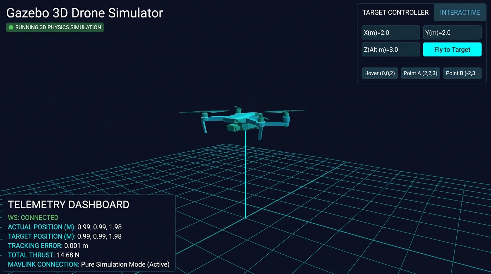

# Quadrotor Backstepping Trajectory Tracking Control

Real-Time Quaternion-Based Backstepping Controller with Gazebo 11 and MuJoCo Simulation

Amrita Vishwa Vidyapeetham

---

## Project Guide

| Role | Name | Email |
|---|---|---|
| Faculty Supervisor | Prof. S. Sunil Kumar | [s_sunilkumar@cb.amrita.edu](mailto:s_sunilkumar@cb.amrita.edu) |

---

## Team Members

| S. No. | Name | Roll Number | Email |
|---:|---|---|---|
| 1 | Kallam Pratheep Reddy | CB.SC.U4AIE24021 | kallampratheepreddy72@gmail.com |
| 2 | Chaithanya G Nambiar | CB.SC.U4AIE24013 | Cb.sc.u4aie24013@cb.students.amrita.edu |
| 3 | Surabhi Saha | CB.SC.U4AIE24057 | saha8.surabhi@gmail.com |
| 4 | Anakha | CB.SC.U4AIE24006 | anakhas443@gmail.com |
| 5 | Mahendra Mula | CB.SC.U4AIE24033 | maheshbanu58@gmail.com |

---

## Abstract

This project implements a real-time Backstepping Quaternion Trajectory Tracking Controller for a quadrotor helicopter. The complete control law of the paper (four-step position backstepping with dynamic thrust extension and independent heading control) is implemented and validated under real rigid-body dynamics in MuJoCo (1.5 kg quadrotor) and gym-pybullet-drones/PyBullet (27 g Crazyflie), with Gazebo 11 (WSL2) as a 3D viewer, a web telemetry dashboard and an ArduPilot/MAVLink bridge. The control design follows the decoupled quaternion parametrization proposed by De Monte and Lohmann (2013), which splits the attitude quaternion into a tilt component $q_{xy}$ and a heading component $q_z$. This decomposition allows the translational and yaw dynamics to be controlled independently, yielding a cleaner and more analytically tractable backstepping procedure.

The system reproduces the paper's switched set-point (Fig. 3) and vertical-helix (Fig. 4) experiments with sub-centimetre accuracy, flies a figure-8 mission, adds Gaussian sensor noise with a Kalman filter state estimator and LiDAR-based obstacle avoidance in a city environment, and streams live 6-DOF telemetry to a WebSocket browser dashboard. An optional ArduPilot SITL/MAVLink bridge (`SITLBridge`) is included for hardware-in-the-loop extension.

---

## 1. Introduction

Autonomous quadrotor navigation requires solving two coupled problems: generating a trajectory that is dynamically feasible, and controlling the vehicle's attitude and position precisely enough to track that trajectory in real time.

Quaternions versus Euler angles. Euler angle representations suffer from gimbal lock, a singularity in which two rotational axes become aligned, causing a loss of one rotational degree of freedom and unstable controller behavior near that configuration. Unit quaternions represent orientation globally and without this singularity. This project uses quaternions throughout the attitude estimation and control pipeline.

Backstepping. Backstepping is a recursive Lyapunov-based design method that exploits the cascaded structure of the quadrotor plant. At each stage of the cascade (position, velocity, thrust, attitude, angular rate), a virtual control law is derived that provably drives the corresponding error to zero, with a Lyapunov function constructed for the complete closed-loop system. This gives a constructive stability proof that purely PID-based approaches do not provide.

Decoupling quaternion parametrization. The key contribution of the base paper (De Monte and Lohmann, 2013) is a factorization $q = q_{xy} \otimes q_z$ that decouples the tilt degree of freedom, which affects translational dynamics, from the heading (yaw) degree of freedom. This allows two independent tracking control laws to be derived analytically within the backstepping framework.

---

## 2. Problem Statement

The objective of this project is to develop and simulate a real-time backstepping controller for a quadrotor that:

- Represents attitude as a unit quaternion, free from gimbal-lock singularities.
- Decomposes attitude into tilt ($q_{xy}$) and heading ($q_z$) to decouple translational and yaw dynamics.
- Executes pre-planned 3D trajectories (hover, helical spiral, figure-8 loop) in physics simulators (Gazebo 11 and MuJoCo).
- Supports real-time custom target setpoints via a CLI utility and file-based inter-process communication.
- Streams live 6-DOF telemetry at 50 Hz via WebSocket to a browser-based dashboard.
- Provides an optional MAVLink bridge for ArduPilot SITL or real hardware integration.

---

## 3. Base Paper

P. De Monte and B. Lohmann (2013). "Trajectory Tracking Control for a Quadrotor Helicopter based on Backstepping using a Decoupling Quaternion Parametrization." 21st Mediterranean Conference on Control and Automation (MED), Platanias-Chania, Crete, Greece, June 25-28, 2013. IEEE.

### Main Contributions of the Paper

- A novel factorization of the attitude quaternion into tilt ($q_{xy}$) and heading ($q_z$) components.
- Proof that this decomposition decouples the translational and yaw dynamics.
- A full backstepping trajectory tracking control law with an analytical Lyapunov stability proof.
- Experimental validation on an AscTec Hummingbird at 50 Hz with a Vicon motion capture system.

### Relation to the Present Project

The present project implements the complete method of the paper in Python (`quadrotor_controller/paper_controller.py`): the quaternion decomposition, heading kinematics (eq. 24), dynamic thrust extension (eq. 31), input transformation (eq. 29), four-step position backstepping (eqs. 32-46) and heading backstepping (eqs. 47-54), with the paper's gains. The Fig. 3 and Fig. 4 experiments are reproduced (`track_error.py`). The earlier simplified two-step law is kept in `controller.py` as a baseline for comparison.

---

## 4. Methodology

The system is implemented as four integrated layers, each independently testable.

---

### 4.1 Quaternion Attitude Parametrization

$$
\dot{q} = \frac{1}{2} Q(q) \begin{bmatrix} \omega \\ 0 \end{bmatrix}
$$

Description: a quaternion $q = (w, x, y, z)$ describes the orientation of the vehicle in 3D space without the gimbal-lock singularity of Euler angles. The equation states that the rate of change of the orientation is half the product of the current orientation and the angular velocity. It propagates the quaternion forward in time as the vehicle rotates.

- $\omega$: angular velocity of the vehicle about each body axis.
- $Q(q)$: matrix built from the current quaternion that encodes the quaternion product.

---

### 4.2 Decoupled Attitude Decomposition

$$
q = q_{xy} \otimes q_z
$$

Description: this is the central idea of the paper. Instead of treating a single quaternion for all rotation, the attitude is split into two simpler parts.

- $q_{xy}$: tilt quaternion. Describes how much the vehicle leans (roll and pitch), which directly sets the thrust direction.
- $q_z$: heading quaternion. Describes the direction the vehicle faces (yaw).
- $\otimes$: quaternion multiplication, i.e. composition of two rotations.

Because of this split, position control and heading control can be designed independently.

The elements are extracted from the full quaternion $q = (q_1, q_2, q_3, q_4)$ as follows.

$$
q_p = \sqrt{q_3^2 + q_4^2}
$$

Here $q_p$ is the magnitude of the heading part, used as a normalizing denominator for the components below.

$$
q_x = \frac{q_4 q_1 - q_3 q_2}{q_p}
$$

$$
q_y = \frac{q_4 q_2 + q_3 q_1}{q_p}
$$

The components $q_x$ and $q_y$ are the tilt components. They describe the direction of the thrust axis relative to vertical.

$$
q_w = \frac{|q_4|}{q_p}
$$

$$
q_z = \mathrm{sgn}(q_3 q_4) \cdot \frac{|q_3|}{q_p}
$$

The components $q_w$ and $q_z$ are the heading components. The sign function ensures the shortest rotation is always selected, which prevents the unwinding phenomenon.

---

### 4.3 Translational Dynamics

$$
\dot{x} = v
$$

$$
m\dot{v} = m g \hat{e}_3 + T
$$

Description: these equations describe the motion of the vehicle through space.

- $\dot{x} = v$: position changes at the rate of the velocity.
- $m\dot{v} = m g \hat{e}_3 + T$: Newton's second law, where $m g \hat{e}_3$ is the gravitational force and $T$ is the thrust force generated by the propellers.

The controller selects $T$ (direction and magnitude) so that gravity is compensated and the vehicle moves toward the target position.

---

---

### 4.4 Backstepping Position Control (paper Sec. III-A, eqs. 25-46)

The translational model is $\dot{x} = v$, $\dot{v} = f(v) + g + \tfrac{1}{m}T$ (eq. 26), and the thrust vector changes through the tilt rates and the thrust rate (eq. 27):

$$
\dot{T} = M(q_{xy})\,D(T)\,R(q_z)\begin{bmatrix}\omega_{xy}\\ \dot{T}\end{bmatrix}
$$

The angular velocity $\omega_z$ does not appear, so position and heading are decoupled. The thrust magnitude is extended by two integrators, $\ddot{T} = u_T$ (eq. 31), which gives a smooth thrust. The input transformation $\tau = -J\omega\times\omega + J\tilde{\tau}$ (eq. 29) gives direct access to $\dot{\omega} = \tilde{\tau}$.

Backstepping is done in four steps, each adding an error and a Lyapunov term:

| Step | Error | Virtual control | Lyapunov function |
|---|---|---|---|
| 1 Position | $z_x = x - x_T$ | $v_d = \dot{x}_T + A_x z_x$ (33) | $V_x = \tfrac12 z_x^\top z_x$ |
| 2 Velocity | $z_v = v - v_d$ | $T_d = m(-f - g + \dot{v}_d - z_x + A_v z_v)$ (37) | $V_v = V_x + \tfrac12 z_v^\top z_v$ |
| 3 Thrust vector | $z_t = T - T_d$ | $[\omega_{xyd};\ \dot{T}_d] = R^\top D^{-1} M^\top(\dot{T}_d + A_t z_t - \tfrac1m z_v)$ (41) | $V_t = V_v + \tfrac12 z_t^\top z_t$ |
| 4 Rates | $z_r = [\omega_{xy}-\omega_{xyd};\ \dot{T}-\dot{T}_d]$ | $[\tilde{\tau}_{xy};\ u_T] = [\dot{\omega}_{xyd};\ \ddot{T}_d] + A_r z_r - R^\top D M^\top z_t$ (45) | $V_\omega = V_t + \tfrac12 z_r^\top z_r$ |

With $A_x, A_v, A_t, A_r < 0$ the closed loop satisfies

$$
\dot{V}_\omega = z_x^\top A_x z_x + z_v^\top A_v z_v + z_t^\top A_t z_t + z_r^\top A_r z_r \le 0 \qquad (46)
$$

so all errors converge to zero. The controller needs $x_T$ and its derivatives up to the 4th order ($x_T \in C^4$). Every derivative of a virtual control ($\dot{T}_d$, $\ddot{T}_d$, $\dot{\omega}_{xyd}$) is computed analytically from the model.

Implementation notes (`quadrotor_controller/paper_controller.py`):
- ENU world frame / FLU body frame (thrust along $+z_B$, $g = (0,0,-9.81)$). The paper uses NED with thrust along $-z_B$; the equations are the same after this sign change.
- The product $M(q_{xy})D(T)R(q_z)$ is evaluated in its equivalent vector form $\dot{T} = R(q)\,[T\omega_y,\,-T\omega_x,\,\dot{T}]^\top$.
- $z_t$ is normalised by the mass ($z_t = (T-T_d)/m$). For $m = 1$ kg this is exactly the paper's law; for other masses it is the same design with a Lyapunov weight $1/m^2$, which lets the same gains work for the 1.5 kg model and the 27 g Crazyflie.
- Drag: $f(v) = -c\,v$ (parameter `drag`, default 0 like the paper's experiments). With drag in the plant, the compensation reduces the helix error from 12.5 cm to 0.3 cm (unit test `test_drag_compensation_term_f_v`).

### 4.5 Heading Control (paper Sec. III-B, eqs. 47-54)

The heading is taken from the heading quaternion, $\varphi = 2\arcsin(q_z)$, and its kinematics follow from the decomposition:

$$
\dot{\varphi} = \omega_z - l(q_{xy})^\top R_s(q_z)\,\omega_{xy} \qquad (24)
$$

(verified numerically in the tests). With $z_\varphi = \mathrm{mod}(\varphi - \varphi_T + \pi, 2\pi) - \pi$:

$$
\omega_{zd} = \dot{\varphi}_T + a_\varphi z_\varphi + l^\top R_s\,\omega_{xy} \quad (48), \qquad
\tilde{\tau}_z = \dot{\omega}_{zd} + a_{\omega z} z_{\omega z} - z_\varphi \quad (52)
$$

which gives $\dot{z}_\varphi = a_\varphi z_\varphi + z_{\omega z}$ and $\dot{z}_{\omega z} = a_{\omega z} z_{\omega z} - z_\varphi$ (53-54), i.e. asymptotic stability that does not depend on the position control.

### 4.6 Reference Trajectories (C⁴ references)

All references carry position, velocity, acceleration, jerk and snap, plus heading, heading rate and heading acceleration (`quadrotor_controller/trajectory.py`).

- **Paper helix (Fig. 4):** $x_T = \sin(\omega_{xy}t)$, $y_T = -2\cos(\omega_{xy}t)$, $z_T = 1 + 0.5\sin(\omega_z t)$, $\varphi_T = \sin(\omega_z t)$ with $\omega_{xy} = 2\pi/6.25$ and $\omega_z = 2\pi/12.5$. The amplitudes are read off Fig. 4: y lags x by a quarter period, the height is 0.5–1.5 m and the heading is ±1 rad.
- **Figure-8 (project extension):** $x_T = 2\sin(\omega t)$, $y_T = \sin(2\omega t)$, $z_T = 1.2 + 0.3\cos(\omega t)$, $\omega = 2\pi/12$.
- **Mission:** takeoff → hover → transfer → helix (4 periods) → transfer → figure-8 (2 periods) → back to hover, repeating. Each manoeuvre starts and ends at rest. The time warp $\tau(t)$ uses a degree-9 smoothstep speed ramp, with derivatives from Faà di Bruno's formula, so the reference stays $C^4$ at every joint and never exceeds the speed of the individual trajectories (2.0 m/s).
- **Set points (`set_target.py X Y Z [heading]`):** a 5th-order critically damped reference model $X_T/X_C = 1/(\tau s+1)^5$ per axis gives $x_T \in C^4$; for heading a 3rd-order model gives $\varphi_T \in C^2$. This is the "reference model" of the paper's Fig. 3 experiment. The time constant grows with the step size so the peak reference speed stays below the limit.

### 4.7 Sensor Noise and Kalman Filter

- `SensorNoiseModel`: Gaussian noise on position ($\sigma = 5$ cm), velocity (8 cm/s) and gyro (0.02 rad/s).
- `KalmanFilter`: 6-state model $[p, v]$ with $F$, $B$, $Q$, $R$, $P$ and the Joseph-form update. The prediction uses the known model acceleration $u = g + R(q)e_3 T/m + f(v)$ from the controller (`model_acceleration`), so the filter does not lag during manoeuvres.
- `AngularRateFilter`: first-order filter on the gyro rates ($\alpha = 0.2$ at 500 Hz).
- Result: position error drops from 8.7 cm (raw) to about 0.5 cm (estimate), and the torque command chatter drops about 80× (see Section 5).

### 4.8 Global path planner (project extension)

The LiDAR only sees a few metres, so set-point flights are planned first on the city map (`path_planner.GridPlanner`, `world_map.WorldMap`), the same in every simulator:

1. If the straight line is free (keeping the clearance), the drone flies straight.
2. If the target is inside a building or obstacle, it is moved to the nearest free point that can be reached.
3. Otherwise the drone climbs or descends vertically to a cruise height (the higher of start and goal). A* finds a route around the blocks at that height, and the route is shortened to the fewest straight legs.
4. If there is no route at that height, the drone flies over the top of the blocking buildings.

The corners of the route are then rounded into one smooth curve, as large as the obstacles allow (`planner.corner_radius`). The first and last bends can start right at the take-off point or the goal, so the drone climbs and turns at the same time instead of flying "straight up, then across". The carrot follows the densely sampled curve, and the reactive LiDAR avoidance stays active. Settings are in `config.yaml` → `planner`. Gazebo has no collision engine for the flight core, so its LiDAR is a ray cast on the same city map.

### 4.9 LiDAR Obstacle Avoidance (project extension)

10 beams: 8 horizontal (45° apart, in the heading frame) plus up and down. In MuJoCo they use `mj_ray`, ignoring the target marker; in PyBullet they use `rayTestBatch`. `ReactiveObstacleAvoider` combines a repulsive potential field with a tangential "wall-following" circulation, and adds two refinements:
- `ignore_behind`: only obstacles in the direction of travel are considered.
- Side memory (hysteresis): once the drone has chosen to pass an obstacle on one side it keeps that side, which removes the local minimum in front of symmetric obstacles.

For set-point flights a lead point (carrot) moves toward the goal, is steered by the avoider and is kept within 0.8 m of the reference. The 5th-order reference model follows the carrot, so the reference stays smooth. With targets placed behind buildings this gave zero collisions in MuJoCo and PyBullet.

---

## 5. Simulation Results

### 5.1 Paper experiments reproduced (`track_error.py`)

Rigid-body model (m = 1.5 kg, J = diag(0.03, 0.03, 0.05) kg m²), RK4 at 500 Hz, paper gains.

| Experiment | Controller | Sensors | RMSE (cm) | Max error (cm) | Heading RMSE (deg) | Max speed (m/s) | Max tilt (deg) | Torque chatter |
|---|---|---|---:|---:|---:|---:|---:|---:|
| Fig. 3 switched set points | Full 4-step paper law | ideal | 0.01 | 0.04 | 0.00 | 1.46 | 12.8 | 0.32 |
| Fig. 3 switched set points | Full 4-step paper law | noise + KF | 0.61 | 1.36 | 0.13 | 1.47 | 13.0 | 3.02 |
| Fig. 3 switched set points | Simplified 2-step (old) | ideal | 13.60 | 36.61 | 8.12 | 1.86 | 16.5 | 0.18 |
| Fig. 4 vertical helix | Full 4-step paper law | ideal | 0.00 | 0.01 | 0.00 | 2.02 | 11.8 | 0.01 |
| Fig. 4 vertical helix | Full 4-step paper law | noise + KF | 0.65 | 1.29 | 0.05 | 2.02 | 12.0 | 3.01 |
| Fig. 4 vertical helix | Full 4-step paper law | noise, no filter | 0.59 | 1.18 | 0.03 | - | - | 249.29 |
| Fig. 4 vertical helix | Simplified 2-step (old) | ideal | 20.62 | 27.41 | 6.60 | 2.33 | 13.7 | 0.02 |
| Mission (takeoff-helix-fig8) | Full 4-step paper law | noise + KF | 0.64 | 1.34 | 0.04 | 2.03 | 12.4 | 3.00 |
| Mission (takeoff-helix-fig8) | Simplified 2-step (old) | noise + KF | 17.01 | 33.73 | 3.99 | 2.34 | 17.5 | 2.98 |

The full table is in [`results_table.md`](results_table.md). Plots and data are in `results/`:

- `helix_fig4.png`: x, y, z and heading versus the reference, in the same layout as the paper's Fig. 4.
- `setpoints_fig3.png`: switched set points, as in Fig. 3.
- `noise_kalman_error.png`: tracking error and torque commands with and without the filter.

Observations:
- With the full 4-step law the error is about 20–40× smaller than with the earlier simplified 2-step PD law, and the heading error is practically zero (decoupling).
- With noise the tracking error stays below 1.5 cm. The Kalman filter's main contribution is the actuator side: the torque-rate RMS drops from 249 to 3 N m/s.
- The paper reports (real Hummingbird) a 1.4 m/s maximum speed and 18° tilt for the helix, and 2.2 m/s and 22° for set-point switching. In simulation the commanded helix reaches 2.0 m/s and 12° tilt; the paper notes its real vehicle reached a smaller amplitude than commanded.

### 5.2 3D simulators: full mission with noise and Kalman filter (75 s, seed 3)

| Phase | MuJoCo (1.5 kg) RMSE / max | PyBullet CF2X (27 g) RMSE / max |
|---|---|---|
| Takeoff | 0.52 / 0.92 cm | 2.16 / 7.00 cm (starts 7 cm below the first reference) |
| Hover | 0.53 / 0.80 cm | 0.53 / 0.80 cm |
| Transfer | 0.65 / 1.21 cm | 0.64 / 1.07 cm |
| Helix (Fig. 4) | 0.58 / 1.23 cm | 0.58 / 1.23 cm |
| Figure-8 | 0.70 / 1.34 cm | 0.70 / 1.33 cm |

In both simulators the drone is moved only by the controller's thrust and torques: MuJoCo actuators, and PyBullet motor RPMs through the CF2X mixer. PyBullet's default numerical velocity damping is switched off for the drone (it slowed a gliding drone from 2.0 to 1.78 m/s in 1 s and caused about 8 cm of helix error).

### 5.3 Gazebo 11 and web dashboard

Gazebo's quadrotor model is kinematic (a 3D viewer). The flight is computed by `PythonFlightSim`: the rigid body at 500 Hz with the same controller, noise, Kalman filter and guidance. Its pose (and the target marker's) reaches Gazebo through a small model plugin, `gazebo_plugin/udp_pose_plugin.cc`, which reads UDP packets every physics step and sets the model pose, so the drone moves smoothly at the controller rate. Build it once in WSL with `bash build_gazebo_plugin.sh` (`run_gazebo.sh` does this automatically). If the plugin is not built, the runners fall back to `gz model` (`gazebo.pose_transport`). Gazebo loads the same generated city as MuJoCo and PyBullet (`models/quadrotor.world`). The web bridge (`run_gazebo_bridge.py`) uses the same core. Tested headless: a dashboard command flew to (2, 2, 3) m with 2 mm error, and helix mode tracked as expected.



### 5.4 3D web dashboard (Gazebo backend)

`START_WEB_DASHBOARD.bat` starts Gazebo 11 in WSL together with the backend, `run_web_dashboard.py`. The backend contains the flight core: the paper controller, sensor noise, Kalman filter, LiDAR on the city map, avoidance and the path planner. It sends every pose to Gazebo and serves the front end `drone_dashboard.html` in the Windows browser at http://localhost:8090.

The front end shows:

- **3D city:** the same generated world as MuJoCo, PyBullet and Gazebo. It has orbit, follow and top cameras, and buildings can be solid, see-through or hidden.
- **On the city:** the flown path, the reference, the planned route curve and the target.
- **Live trajectory values:** time, mode, position, reference, error, velocity, speed, roll/pitch/yaw, body rates, thrust, torques, Kalman-filter error, sensor noise, Lyapunov value, LiDAR status, goal and route.
- **Charts** of x, y, z (actual vs reference), error, speed and thrust over the last 60 s, with hover values.

**Targets:** type X Y Z (and a heading), or click the ground or a roof. Hovering over the city shows building heights and footprints. **Check route** answers the question "can the drone fly between the buildings?" before it flies. It reports a straight path, a path between buildings with the narrowest gap width, a route around the obstacles, or a route over the top. It also says when a target inside a building has been moved, and it gives the route length, the minimum clearance and an estimated flight time. The route is drawn as a dashed preview.

**Export:** all trajectory values, one row per simulated second (32 columns), as CSV or JSON. Each export is also saved in `results/`.

The backend uses only the Python standard library and numpy, and three.js is bundled in `web_vendor/`, so the dashboard runs without internet. API: `GET /api/telemetry`, `/api/world`, `/api/route`, `/api/export.csv` and `/api/export.json`; `POST /api/command`, `/api/check_route` and `/api/clear_log`.

### 5.5 ArduPilot / MAVLink

`SITLBridge` converts ArduPilot's NED/FRD state to ENU/FLU and sends the paper controller's body-rate reference $(\omega_{xd}, \omega_{yd}, \omega_{zd})$ and thrust with `SET_ATTITUDE_TARGET`; ArduPilot's rate loop tracks them. `run_ardupilot_sitl.py` runs the full ground-station sequence:

1. Start SITL or connect to it (`mavlink.launch`: `none` / `dronekit` / `command`).
2. Request `ATTITUDE` and `LOCAL_POSITION_NED` at 50 Hz (`SET_MESSAGE_INTERVAL`).
3. Read `MOT_THST_HOVER` (`hover_throttle: auto`) and set `GUID_OPTIONS = 8` (thrust field is thrust), checking each `PARAM_VALUE`.
4. Wait for the EKF position, switch to GUIDED and arm, each confirmed by the heartbeat. Autopilot `STATUSTEXT` messages (pre-arm failures) are printed.
5. Fly with the paper controller and send a 1 Hz GCS heartbeat. Control is released if the pilot or a failsafe changes the mode.
6. LAND and wait for the autopilot to disarm.

`mock_mavlink_vehicle.py` behaves like ArduCopter for this sequence: parameters, modes, pre-arm checks, command ACKs, EKF start-up delay, and LAND with auto-disarm. Against it, the vehicle flew from (0, 0, 0.2) to (1, 1, 2) m in about 5 s with no overshoot (final error < 1 mm), then landed and disarmed.

---

## 6. Controller Gains

| Gain | Paper symbol | Value (paper Sec. IV) | Acts on |
|---|---|---:|---|
| `k_x` | $A_x$ | −1 | position error $z_x$ |
| `k_v` | $A_v$ | −3 | velocity error $z_v$ |
| `k_t` | $A_t$ | −8 | thrust-vector error $z_t$ |
| `k_r` | $A_r$ | −12 | rate error $z_r$ |
| `k_phi` | $a_\varphi$ | −2 | heading error $z_\varphi$ |
| `k_wz` | $a_{\omega z}$ | −12 | yaw-rate error $z_{\omega z}$ |

The same gains are used in every simulator. In code they are stored as positive numbers $k = -A$ (`PaperGains`). Thrust limits: $0.15\,mg \le T \le 2.5\,mg$; for the Crazyflie, 90 % of $4 k_f\,\mathrm{RPM}_{max}^2$.

---

## 7. System Architecture

```
quadrotor_controller/            shared by every simulator
  paper_controller.py   PaperBacksteppingController  (eqs. 24-54)
  trajectory.py         paper helix, figure-8, C^4 mission, 5th-order reference model
  guidance.py           ReferenceManager: target.txt commands, mode switching, avoidance
  kalman_filter.py      SensorNoiseModel, KalmanFilter, AngularRateFilter
  obstacle_avoidance.py LidarScan, ReactiveObstacleAvoider
  dynamics.py           RigidBodyQuadrotor (RK4)
  sim_core.py           PythonFlightSim (rigid body + controller + KF + guidance)
  sitl_bridge.py        SITLBridge (MAVLink, NED/FRD <-> ENU/FLU)
  config.py             config.yaml loader (strict cfg('a.b'), --config / --set, fallback parser)
  units.py              unit conversions, MuJoCo / PyBullet array layouts
  world_geometry.py     static world read from the MuJoCo model (used to build the PyBullet city)
  world_builder.py      procedural city (config world.*) -> MuJoCo include + Gazebo SDF
  gazebo_tools.py       WSL path / environment helpers for Gazebo
  controller.py         quaternion utilities, decompose_attitude, simplified 2-step law (baseline)

run_mujoco_simulation.py     MuJoCo 500 Hz, actuators T + tau, mj_ray LiDAR
run_pybullet_simulation.py   gym-pybullet-drones CF2X, physics 1 kHz / control 500 Hz, RPM mixer
run_gazebo_wsl_native.py     inside WSL: PythonFlightSim -> gz model (Gazebo viewer)
run_gazebo_simulation.py     on Windows: PythonFlightSim -> UDP 9090 -> wsl_sync_gazebo.py
run_gazebo_bridge.py         PythonFlightSim or MAVLink -> WebSocket 8081 + HTTP 8080 dashboard
run_ardupilot_sitl.py        paper controller over MAVLink (dronekit-sitl or --connect)
mock_mavlink_vehicle.py      MAVLink quadrotor for offline tests
run_web_dashboard.py         web backend: flight core + Gazebo output + JSON API (stdlib HTTP server)
drone_dashboard.html         web front end: 3D city (three.js), live values, charts, route check, export
web_vendor/                  bundled three.js r128 (offline)
START_WEB_DASHBOARD.bat      Gazebo + web backend in WSL, browser on Windows
track_error.py               paper experiments (Fig. 3, Fig. 4, mission) -> results/
set_target.py                writes target.txt (read by every runner)
config.yaml                  every tunable value (see Section 8)
gazebo_env.py                exports the Gazebo settings for run_gazebo.sh
generate_world.py            writes models/city.xml (MuJoCo/PyBullet) and models/quadrotor.world (Gazebo)
gazebo_plugin/               udp_pose_plugin.cc - Gazebo model plugin: UDP pose -> model (build_gazebo_plugin.sh)
models/gazebo_quadrotor.sdf  Gazebo drone model template inserted into the generated world
```

---

## 8. Configuration (`config.yaml`)

No tunable value is written in the code. Every setting lives in **`config.yaml`** in the project folder, grouped in sections:

| Section | Contents |
|---|---|
| `paths` | target file, results folder, MuJoCo model (also the PyBullet city), Gazebo world, gym-pybullet-drones folder |
| `vehicle` | mass, inertia, gravity, drag, thrust limits |
| `controller` | the paper's gains (k = −A) and numerical guards |
| `baseline_controller` | the old simplified 2-step law (for comparison) |
| `noise`, `estimator` | sensor noise σ, Kalman filter Q, gyro filter α |
| `trajectory`, `reference_model` | helix (Fig. 4), figure-8, mission timing, set-point reference model |
| `guidance`, `avoidance` | target.txt polling, landing point, carrot / offset avoidance, LiDAR avoider |
| `mujoco`, `pybullet`, `python_sim`, `gazebo`, `bridge` | simulator rates, cameras, HUD, WSL/Pixi/VcXsrv paths, ports |
| `mavlink`, `mock_vehicle` | MAVLink connection, hover throttle, target, stand-in vehicle |
| `experiments` | `track_error.py` (Fig. 3 commands, Fig. 4 duration, plots, paper reference values) |
| `logging`, `numerics` | print/CSV periods, banner width, tolerances |

- Change a value permanently by editing `config.yaml`.
- Change it for one run with `--set`, e.g. `python run_mujoco_simulation.py --set controller.k_x=1.5 --set noise.pos_std=0.1`.
- Use another file with `--config my_setup.yaml`, or set the `DRONES_CONFIG` environment variable.
- Look-ups are strict: a missing key stops the program with a message naming the key, so there are no hidden defaults.
- The `.bat` and `.sh` launchers find their own folder, so the project can live anywhere, not only `D:\Drones`. Set `DRONES_PYTHON` to choose a specific Python.
- `tests/test_config.py` fails if a number is hard-coded again.

Physical unit conversions and the array layouts of MuJoCo and PyBullet are named constants in `quadrotor_controller/units.py`.

---

## 9. Prerequisites and Installation

| Component | Requirement |
|---|---|
| OS | Windows 10/11 (WSL2 Ubuntu 22.04 for Gazebo) |
| Python | 3.9+ |
| Packages | `numpy mujoco pybullet gymnasium websockets matplotlib pymavlink` (`dronekit-sitl` optional) |
| gym-pybullet-drones | used directly from `gym_pybullet_drones_repo` (`paths.gym_pybullet_drones`); optional `pip install -e gym_pybullet_drones_repo --no-deps` |
| Gazebo | Gazebo 11 via Pixi inside WSL + VcXsrv (see [`GAZEBO_INSTALLATION_GUIDE.md`](GAZEBO_INSTALLATION_GUIDE.md)) |

```powershell
cd d:\Drones
pip install numpy mujoco pybullet gymnasium websockets matplotlib pymavlink pytest pyyaml
pip install -e gym_pybullet_drones_repo --no-deps   # optional; --no-deps avoids torch / pybullet 3.2.7 builds
```

Inside WSL, the Gazebo Python (`gazebo.pixi_env`/bin/python3) needs `numpy`. PyYAML is optional there, because `config.py` has a built-in parser for `config.yaml`.

---

## 10. How to Run

| What | Command |
|---|---|
| MuJoCo 3D viewer | `START_MUJOCO_SIM.bat` or `python run_mujoco_simulation.py` |
| PyBullet 3D GUI | `START_PYBULLET_SIM.bat` or `python run_pybullet_simulation.py` |
| Gazebo 11 (WSL) | `START_GAZEBO_GUI.bat` (recommended) or `python run_gazebo_simulation.py` |
| **3D web dashboard + Gazebo** | `START_WEB_DASHBOARD.bat` (Gazebo + backend in WSL, opens http://localhost:8090) |
| 3D web dashboard, backend on Windows | `python run_web_dashboard.py --gazebo --open-browser`, or without Gazebo `python run_web_dashboard.py --open-browser` |
| Old telemetry page (MAVLink) | `launch_web_visualizer.bat`, then open http://127.0.0.1:8080/gazebo_visualizer.html |
| ArduPilot SITL | start SITL (`sim_vehicle.py -v ArduCopter --out udp:127.0.0.1:14550`), then `python run_ardupilot_sitl.py --connect`; or `--launch dronekit` |
| Offline MAVLink demo | `python mock_mavlink_vehicle.py` and, in a second terminal, `python run_ardupilot_sitl.py --connect` |
| Regenerate the city | `python generate_world.py` (after changing `config.yaml` → `world`) |
| Build the Gazebo pose plugin | in WSL: `bash build_gazebo_plugin.sh` (done automatically by `run_gazebo.sh`) |
| Paper experiments + plots | `python track_error.py` |
| Tests | `python -m pytest tests -v` |

Useful options for MuJoCo / PyBullet: `--headless --duration 60`, `--log run.csv`, `--no-noise`, `--no-filter`, `--no-avoid`, `--seed N`, `--ignore-target-file`, `--config file.yaml`, `--set key=value`.

### Simulation world and viewer controls

All three simulators fly in the same procedurally generated city (`config.yaml` → `world`, seed 7). It contains a central plaza with a helipad and three avoidance-demo obstacles (clock tower, café, metro entrance), a ring road and avenues with lane markings and zebra crossings, sidewalks with trees, street lamps and traffic lights, parked cars, and 2- to 15-storey buildings with window bands, roof units and antenna beacons. The world has 1307 primitives, 237 of them solid.

PyBullet viewer (normal 1280×720 window, side panels hidden, shadows on, live values in the top-left corner):

| Key | Action |
|---|---|
| `1` / `2` / `3` | follow drone / overview / top view |
| `4` | trail on / off |
| arrows | rotate / tilt the camera |
| `=` / `-` | zoom |
| mouse | Ctrl + left-drag rotate, Ctrl + middle-drag pan, wheel zoom |

MuJoCo: the side panels are hidden (`mujoco.show_side_panels`). The viewer has a flight trail and a HUD; mouse drag rotates the view and the wheel zooms.

### Commands while flying (`set_target.py`)

```powershell
python set_target.py auto          # takeoff -> hover -> paper helix -> figure-8 (looping)
python set_target.py spiral        # paper helix (Fig. 4)
python set_target.py figure8       # figure-8
python set_target.py 5 5 10        # fly to a point (C^4 reference model)
python set_target.py 3 -2 2.5 90   # point + heading in degrees
python set_target.py hover         # hold (0, 0, 1 m)
python set_target.py land          # return to the helipad
```

The runners poll `target.txt` every 0.25 s; every mode change is smooth, with no jumps in the reference.

---

## 11. Running Tests

`python -m pytest -v` runs 56 tests (`pytest.ini` limits collection to `tests/`). The main groups:

| Test file | What it checks |
|---|---|
| `test_paper_controller.py` | eq. (24) heading kinematics vs finite differences; hover equilibrium T = mg, τ = 0; sub-mm helix tracking; heading ±1 rad; the Lyapunov function never increases (eq. 46); drag compensation; thrust limits |
| `test_trajectory_guidance.py` | Fig. 4 helix parameters; derivatives up to snap; C⁴ mission joints and speed bound; reference model convergence and speed limit; target.txt parsing; continuous mode switching; avoider side memory |
| `test_mujoco_sim.py` | model, stepping, paper controller flying MuJoCo to a point under real dynamics |
| `test_pybullet_sim.py` | CtrlAviary, mixer, paper controller hovering the Crazyflie at 1 m |
| `test_mavlink_preflight.py` | full MAVLink pre-flight against the mock ArduCopter: streams, MOT_THST_HOVER, GUID_OPTIONS, EKF, GUIDED, arm, land and disarm |
| `test_path_planner.py` | LiDAR ray cast on the city map, routes free of obstacles, target inside a building moved out, Gazebo flight core reaches (12, 10, 9) without touching anything |
| `test_web_dashboard.py` | web API, route check (between buildings / target moved / over the top), export with one row per second |
| `test_config.py` | config loading, `--set` / `--config` overrides, fallback parser = PyYAML, **no hard-coded numbers in the code** |
| `test_kalman_filter.py`, `test_obstacle_avoidance.py`, `test_sitl_bridge.py`, `test_controller.py` | noise, KF, LiDAR, MAVLink and frame conversions, quaternion utilities |

---

## 12. Key Observations

1. The decomposition $q = q_{xy}\otimes q_z$ makes position and heading independent: the heading follows ±1 rad during the helix with practically zero error, and position tracking is unaffected.
2. The full 4-step law, with the dynamic thrust extension and analytic derivatives, is about 20–40× more accurate than the 2-step PD simplification with the same structure.
3. The law needs a C⁴ reference. Blending moving trajectories directly produced speed overshoots (3.1 m/s); rest-to-rest speed ramps fixed this.
4. Feeding the model acceleration to the Kalman filter is essential: without it the filter lags (11.5 cm error); with it the error is 0.65 cm and the motor commands are about 80× smoother.
5. Unmodelled drag-like effects show up directly as tracking error (PyBullet damping: 8 cm). The paper's $f(v)$ term compensates for them when modelled.

## 13. Limitations

- Gazebo is used as a viewer for the Python rigid-body physics (the quadrotor model is kinematic).
- Rotor dynamics are not modelled; the motors are assumed to reach the commanded thrust and torques instantly, as in the paper.
- Drag is linear ($f(v) = -c v$) and set to 0 by default.
- ArduPilot was tested against a MAVLink stand-in vehicle; real ArduCopter SITL still has to be run on Windows/WSL.
- Obstacle avoidance is reactive (LiDAR); targets closer to a building than the safety distance are held at that distance.

## 14. Future Work

- Uneven terrain (heightfield ground) with terrain-following and landing on slopes.
- Attitude estimation from IMU (EKF / Mahony) instead of the true quaternion.
- Adaptive extension for unknown mass and drag (mentioned by the paper's authors).
- Run on real ArduCopter SITL and hardware through `SITLBridge`.

## 15. Conclusion

The project implements the complete backstepping trajectory-tracking controller of De Monte and Lohmann (2013): the decoupling quaternion parametrisation, the dynamic thrust extension, the four-step position design with its Lyapunov proof, and the independent heading control. It reproduces the paper's set-point (Fig. 3) and vertical-helix (Fig. 4) experiments with sub-centimetre accuracy. The same controller, gains, sensor noise model and Kalman filter fly a 1.5 kg quadrotor in MuJoCo and a 27 g Crazyflie in PyBullet under real rigid-body dynamics, drive the Gazebo viewer and the web dashboard, and command a MAVLink vehicle.

---

## 16. References

1. P. De Monte and B. Lohmann, "Trajectory Tracking Control for a Quadrotor Helicopter based on Backstepping using a Decoupling Quaternion Parametrization," 21st Mediterranean Conference on Control and Automation (MED), Crete, Greece, June 2013, pp. 507-512. IEEE. (Base paper)
2. M. Krstic, I. Kanellakopoulos, and P. Kokotovic, Nonlinear and Adaptive Control Design, John Wiley & Sons, 1995.
3. S. P. Bhat and D. S. Bernstein, "A topological obstruction to continuous global stabilization of rotational motion and the unwinding phenomenon," Systems & Control Letters, vol. 39, pp. 63-70, 2000.
4. O. Fritsch, P. De Monte, M. Buhl, and B. Lohmann, "Quasi-static feedback linearization for the translational dynamics of a quadrotor helicopter," Proc. American Control Conference, 2012.
5. T. Hamel, R. Mahony, R. Lozano, and J. Ostrowski, "Dynamic modelling and configuration stabilization for an X4-Flyer," Proc. 15th IFAC World Congress, 2002.
6. E. Todorov, T. Erez, and Y. Tassa, "MuJoCo: A physics engine for model-based control," IEEE/RSJ IROS, 2012.
7. J. Panerati et al., "Learning to Fly - a Gym Environment with PyBullet Physics for Reinforcement Learning of Multi-agent Quadcopter Control," IEEE/RSJ IROS, 2021. (gym-pybullet-drones)
