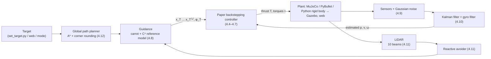
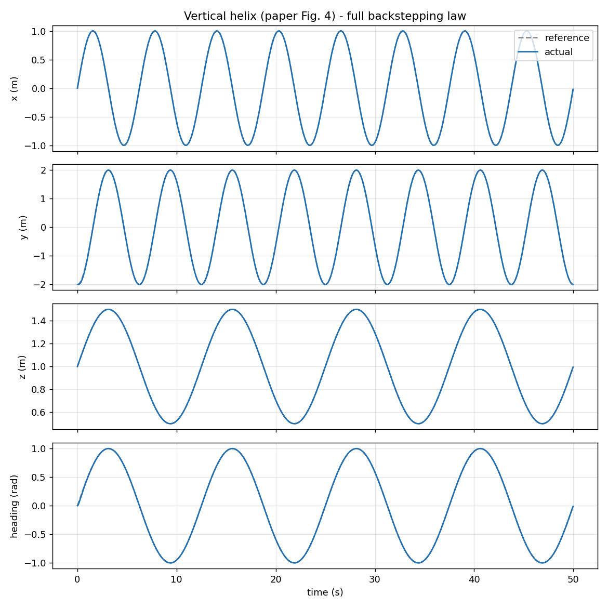
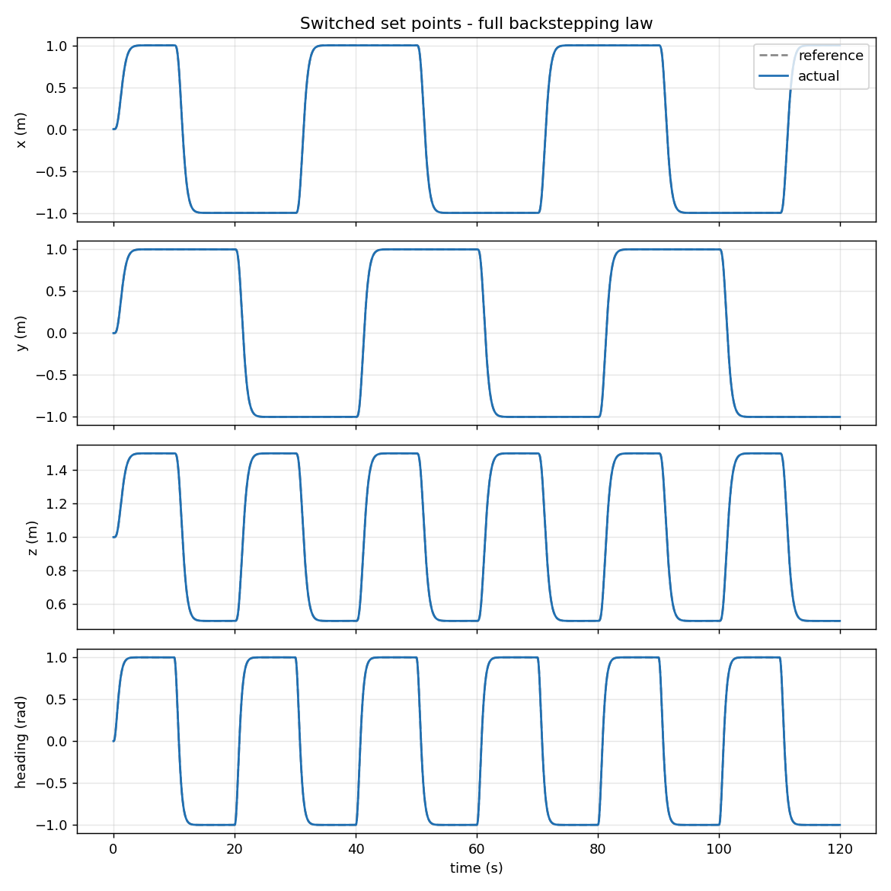
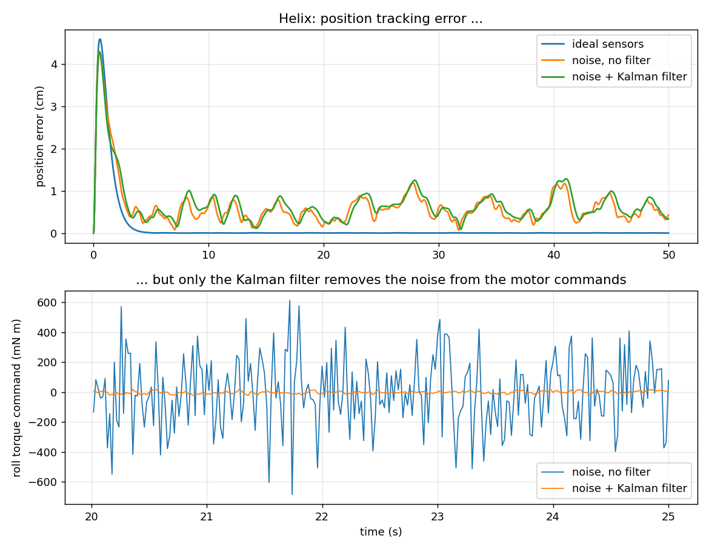

# Quadrotor Backstepping Trajectory Tracking Control

Quaternion-based backstepping trajectory tracking (De Monte & Lohmann, 2013) with sensor noise, Kalman filtering, LiDAR obstacle detection and trajectory redirection, simulated in MuJoCo, PyBullet, Gazebo 11 and a 3D web dashboard.

Amrita Vishwa Vidyapeetham


---

## Project Guide

| Role | Name | Email |
|---|---|---|
| Faculty Supervisor | Prof. S. Sunil Kumar | [s_sunilkumar@cb.amrita.edu](mailto:s_sunilkumar@cb.amrita.edu) |

---

## Team Members

| S. No. | Name | Roll Number | Email |
|---:|---|---|---|
| 1 | Kallam Pratheep Reddy | CB.SC.U4AIE24021 | kallampratheepreddy72@gmail.com |
| 2 | Chaithanya G Nambiar | CB.SC.U4AIE24013 | Cb.sc.u4aie24013@cb.students.amrita.edu |
| 3 | Surabhi Saha | CB.SC.U4AIE24057 | saha8.surabhi@gmail.com |
| 4 | Anakha | CB.SC.U4AIE24006 | anakhas443@gmail.com |
| 5 | Mahendra Mula | CB.SC.U4AIE24033 | maheshbanu58@gmail.com |

---

## Contents

1. [Abstract](#abstract)
2. [Introduction](#1-introduction)
3. [Problem Statement](#2-problem-statement)
4. [Base Paper](#3-base-paper)
5. [Methodology](#4-methodology): quaternion model, backstepping control, references, noise, Kalman filter, object detection, trajectory redirection
6. [Simulation](#5-simulation): city world, MuJoCo, PyBullet, Gazebo 11, 3D web dashboard, ArduPilot
7. [Results](#6-results): paper experiments, noise and Kalman filter, obstacle detection, redirected trajectories, city flight
8. [Architecture, configuration, installation, running, tests](#7-system-architecture)

---

## Abstract

This project implements the complete backstepping trajectory tracking controller of De Monte and Lohmann (2013) for a quadrotor helicopter. The attitude quaternion is split into a tilt part $`q_{xy}`$, which orients the thrust vector, and a heading part $`q_z`$. With this split, the translational dynamics and the yaw dynamics decouple. Position is controlled by a four-step backstepping design with a dynamic thrust extension, and heading by an independent two-step design. Both come with a Lyapunov proof of asymptotic stability.

The paper's controller is extended into a full guidance, navigation and control system:

- **Noise and filtering:** Gaussian sensor noise on position, velocity and gyro, a 6-state Kalman filter that uses the controller's model acceleration as input, and a gyro filter.
- **Obstacle detection:** a 10-beam LiDAR and a reactive avoider (repulsive field, wall-following circulation, side memory).
- **Trajectory redirection:** a global path planner (A* on the city map, targets inside buildings moved out, over-the-top fallback). Its corners are rounded into one smooth $`C^1`$ curve that the drone follows through a $`C^4`$ reference model.

The same code flies a 1.5 kg quadrotor in MuJoCo and a 27 g Crazyflie in PyBullet under real rigid-body dynamics. It also drives Gazebo 11 and a 3D web dashboard through a 500 Hz Python flight core. The dashboard shows live trajectory values and charts, checks whether a route between buildings is possible before flying, and exports all trajectory values once per second. An ArduPilot / MAVLink bridge runs the full ground-station pre-flight sequence.

The paper's switched set-point and vertical-helix experiments are reproduced with sub-centimetre error. With noise and the Kalman filter, every simulator tracks the mission with about 0.5–0.7 cm RMS error. In the city, the drone reaches targets behind and between buildings while keeping more than 1.5 m from every obstacle.

---

## 1. Introduction

Autonomous quadrotor flight needs two things at once: a trajectory that is dynamically feasible and collision-free, and a controller that tracks it precisely in real time.

**Quaternions versus Euler angles.** Euler angles suffer from gimbal lock: at certain attitudes two rotation axes align and one degree of freedom is lost. Unit quaternions describe every attitude without this singularity. This project uses quaternions throughout the model and the controller.

**Backstepping.** Backstepping is a recursive, Lyapunov-based design for systems in cascade form (position → velocity → thrust → angular rate). At each step a virtual control drives one error to zero, and the Lyapunov function is extended by that error. The result is a constructive proof of stability for the complete closed loop.

**Decoupling quaternion parametrization.** The key idea of the base paper is the factorization $`q = q_{xy} \circ q_z`$. The tilt quaternion $`q_{xy}`$ alone determines the direction of the thrust and therefore the translational motion. The heading quaternion $`q_z`$ determines only the yaw. Position and heading can therefore be controlled by two independent laws, and all control signals can be derived analytically.

---

## 2. Problem Statement

Develop and simulate a real-time trajectory tracking system for a quadrotor that:

- Represents the attitude by a unit quaternion, decomposed into tilt $`q_{xy}`$ and heading $`q_z`$ (no gimbal lock, no unwinding).
- Implements the paper's full backstepping law: four-step position control with dynamic thrust extension, and heading control.
- Tracks the paper's reference trajectories (switched set points, vertical helix) and project trajectories (figure-8, mission, arbitrary set points).
- Works with realistic sensors: additive Gaussian noise on position, velocity and gyro, with a Kalman filter for state estimation.
- Detects obstacles with an onboard LiDAR and avoids them.
- Redirects the trajectory around buildings: plans a collision-free route, moves targets that are inside buildings, and flies a smooth curve instead of sharp corners.
- Runs the same controller in several simulators (MuJoCo, PyBullet, Gazebo 11) in one shared, realistic city.
- Provides a 3D web interface for targets, route checking, live values and per-second data export, plus a MAVLink bridge for ArduPilot.

---

## 3. Base Paper

P. De Monte and B. Lohmann (2013). "Trajectory Tracking Control for a Quadrotor Helicopter based on Backstepping using a Decoupling Quaternion Parametrization." 21st Mediterranean Conference on Control and Automation (MED), Platanias-Chania, Crete, Greece, June 25-28, 2013, pp. 507-512. IEEE.

### Main contributions of the paper

- A factorization of the attitude quaternion into tilt ($`q_{xy}`$) and heading ($`q_z`$) quaternions, free of ambiguity ($`q_p \ge 0`$, $`q_w \ge 0`$).
- Proof that this decomposition decouples the translational dynamics from the yaw dynamics.
- A backstepping trajectory tracking law with an analytical Lyapunov stability proof, in which every control signal is derived analytically.
- Experimental validation on an AscTec Hummingbird with a Vicon motion-capture system.

### What this project implements

The complete method of the paper is in `quadrotor_controller/paper_controller.py`:

- the quaternion decomposition
- the thrust-vector and heading kinematics
- the input transformation and the dynamic thrust extension
- the four-step position backstepping and the heading backstepping
- the paper's gains

`track_error.py` reproduces the paper's switched set-point and vertical-helix experiments. The earlier simplified two-step law (`controller.py`) is kept as a baseline.

---

## 4. Methodology

The system is a closed loop of five blocks. Every simulator uses the same blocks; only the "plant" changes.



### 4.1 Quaternion fundamentals and conventions

The paper writes a unit quaternion with the vector part first and the scalar part last:

```math
q = [\,q_1\ \ q_2\ \ q_3\ \ q_4\,]^\top = \Big[\,a^\top \sin\tfrac{\alpha}{2}\ \ \ \cos\tfrac{\alpha}{2}\,\Big]^\top, \qquad \lVert q\rVert = 1
```

Here $`a`$ is the rotation axis and $`\alpha`$ the rotation angle. A vector given in the body frame B is transformed to the inertial frame I by $`^{I}x = R(q)\,{}^{B}x`$. The quaternion kinematics are

```math
\dot q = \tfrac12\,Q(q)\begin{bmatrix}\omega\\ 0\end{bmatrix}, \qquad
Q(q) = \begin{bmatrix} q_4 & -q_3 & q_2 & q_1\\ q_3 & q_4 & -q_1 & q_2\\ -q_2 & q_1 & q_4 & q_3\\ -q_1 & -q_2 & -q_3 & q_4\end{bmatrix}
```

where $`\omega`$ is the angular velocity of the body, expressed in the body frame. $`Q(p)\,r`$ is the quaternion product $`p \circ r`$.

> **Conventions in the code.** The code stores quaternions scalar-first, $`q = (w, x, y, z) = (q_4, q_1, q_2, q_3)`$.
>
> The world frame is ENU (z up) and the body frame is FLU, so the thrust acts along $`+z_B`$ and gravity is $`g = (0, 0, -9.81)`$ m/s². The paper uses NED with the thrust along $`-z_B`$. After this sign change all equations are identical.

### 4.2 Decoupling attitude parametrization

The rotation from I to B is split into two consecutive rotations through an auxiliary frame A whose z-axis coincides with the body z-axis:

```math
q = q_{xy} \circ q_z = Q(q_{xy})\,q_z
```

| Quaternion | Structure | Meaning | Degrees of freedom |
|---|---|---|---|
| $`q_{xy} = [\,q_x\ \ q_y\ \ 0\ \ q_p\,]^\top`$ | rotation about an axis in the horizontal plane | **tilt**: orientation of the thrust vector | 2, since $`q_p^2+q_x^2+q_y^2 = 1`$ |
| $`q_z = [\,0\ \ 0\ \ q_z\ \ q_w\,]^\top`$ | rotation about the body z-axis | **heading** (yaw) | 1, since $`q_w^2+q_z^2 = 1`$ |

The components are computed from the full quaternion:

```math
q_p = \sqrt{q_3^2 + q_4^2}, \qquad
q_x = \frac{q_4\,q_1 - q_3\,q_2}{q_p}, \qquad
q_y = \frac{q_4\,q_2 + q_3\,q_1}{q_p}
```

```math
q_w = \frac{|q_4|}{q_p}, \qquad q_z = \mathrm{sgn}(q_3 q_4)\,\frac{|q_3|}{q_p}, \qquad \mathrm{sgn}(0) = +1
```

- $`q_p = \cos(\theta/2)`$ is the scalar part of the tilt quaternion, where $`\theta`$ is the tilt angle of the thrust axis from vertical. $`q_x`$ and $`q_y`$ give the tilt axis. $`q_p > 0`$ as long as the vehicle is not upside down, so $`q_{xy}`$ is continuous.
- $`q_w`$ and $`q_z`$ are the cosine and sine of half the heading angle. The heading angle is $`\varphi = 2\arcsin q_z`$.
- Choosing $`q_p \ge 0`$ and $`q_w \ge 0`$ removes the sign ambiguity of quaternions. The controller therefore always turns through the shortest angle, which avoids the *unwinding* phenomenon.

### 4.3 Thrust vector and heading kinematics

Because the thrust acts along the body z-axis, which is also the z-axis of the A-frame, the thrust vector depends only on $`q_{xy}`$. In the paper's NED frame:

```math
\mathbf T = R(q_{xy})\begin{bmatrix}0\\0\\-T\end{bmatrix} = \begin{bmatrix} -2q_y q_p\\ 2q_x q_p \\ 1 - 2q_p^2\end{bmatrix} T
```

Here $`T`$ is the thrust magnitude. Its time derivative depends only on the tilt rates $`\omega_{xy} = [\omega_x\ \omega_y]^\top`$ and the thrust rate $`\dot T`$:

```math
\dot{\mathbf T} = M(q_{xy})\,D(T)\,R_s(q_z)\begin{bmatrix}\omega_{xy}\\ \dot T\end{bmatrix}, \qquad D(T) = \mathrm{diag}(T, T, 1)
```

$`M(q_{xy})`$ is orthogonal ($`M^{-1} = M^\top`$), and $`R_s(q_z)`$ rotates $`\omega_{xy}`$ from the B-frame into the A-frame. The yaw rate $`\omega_z`$ does not appear, so it cannot disturb the position. The heading angle obeys

```math
\dot\varphi = \omega_z - l(q_{xy})^\top R_s(q_z)\,\omega_{xy}, \qquad l(q_{xy}) = \tfrac{1}{q_p}[\,q_y\ \ -q_x\,]^\top
```

This equation is verified numerically against finite differences in the tests.

### 4.4 Dynamic model

The quadrotor is a rigid body. The motor dynamics are fast compared with the vehicle, so, as in the paper, the total thrust and the three body torques are the plant inputs.

```math
\dot x = v, \qquad \dot v = f(v) + g + \tfrac{1}{m}\mathbf T
```

```math
\dot\omega = J^{-1}\big(J\omega\times\omega + \tau\big)
```

- **Drag:** $`f(v)`$ models drag. Here it is linear, $`f(v) = -c\,v`$; the paper's experiments and the default setting use $`c = 0`$.
- **Input transformation:** $`\tau = -J\omega\times\omega + J\tilde\tau`$ cancels the gyroscopic term and gives direct access to the angular acceleration, $`\dot\omega = \tilde\tau`$.
- **Dynamic thrust extension:** two integrators are added for the thrust magnitude, $`\ddot T = u_T`$. The thrust becomes a state, its command is smooth, and $`\dot T`$ and $`\ddot T`$ are available to the design.

The plant inputs used by the design are therefore $`\tilde\tau_{xy}`$, $`u_T`$ (position) and $`\tilde\tau_z`$ (heading).

### 4.5 Backstepping position control

Each step defines an error, chooses a virtual control that makes the derivative of the Lyapunov function negative, and passes the remaining coupling term to the next step:

| Step | Error | Virtual / real control | Lyapunov function |
|---|---|---|---|
| 1 Position | $`z_x = x - x_T`$ | $`v_d = \dot x_T + A_x z_x`$ | $`V_x = \tfrac12 z_x^\top z_x`$ |
| 2 Velocity | $`z_v = v - v_d`$ | $`\mathbf T_d = m\big(-f - g + \dot v_d - z_x + A_v z_v\big)`$ | $`V_v = V_x + \tfrac12 z_v^\top z_v`$ |
| 3 Thrust vector | $`z_t = \mathbf T - \mathbf T_d`$ | $`\begin{bmatrix}\omega_{xyd}\\ \dot T_d\end{bmatrix} = R_s^\top D^{-1} M^\top\big(\dot{\mathbf T}_d + A_t z_t - \tfrac1m z_v\big)`$ | $`V_t = V_v + \tfrac12 z_t^\top z_t`$ |
| 4 Rates | $`z_r = \begin{bmatrix}\omega_{xy}-\omega_{xyd}\\ \dot T-\dot T_d\end{bmatrix}`$ | $`\begin{bmatrix}\tilde\tau_{xy}\\ u_T\end{bmatrix} = \begin{bmatrix}\dot\omega_{xyd}\\ \ddot T_d\end{bmatrix} + A_r z_r - R_s^\top D M^\top z_t`$ | $`V_\omega = V_t + \tfrac12 z_r^\top z_r`$ |

With $`A_x, A_v, A_t, A_r < 0`$ all cross terms cancel and

```math
\dot V_\omega = z_x^\top A_x z_x + z_v^\top A_v z_v + z_t^\top A_t z_t + z_r^\top A_r z_r \;\le\; 0
```

so all errors converge to zero asymptotically.

- **Reference smoothness:** the law needs the reference position and its derivatives up to the 4th order ($`x_T \in C^4`$).
- **Analytic derivatives:** every derivative of a virtual control ($`\dot{\mathbf T}_d`$, $`\ddot T_d`$, $`\dot\omega_{xyd}`$) is computed analytically from the model. Nothing is differentiated numerically.
- **Thrust error:** $`z_t^\top z_t = \tilde T^2 + 2T_d(\tilde T + T_d)(1-\cos\alpha_e)`$, where $`\tilde T`$ is the magnitude error and $`\alpha_e`$ the angle between $`\mathbf T`$ and $`\mathbf T_d`$. The design therefore removes the magnitude error and rotates the thrust vector the short way.

Implementation notes:

- $`z_t`$ is normalised by the mass, $`z_t = (\mathbf T - \mathbf T_d)/m`$. For $`m = 1`$ kg this is exactly the paper's law. For other masses it is the same design with the Lyapunov weight $`1/m^2`$, which lets the same gains fly the 1.5 kg model and the 27 g Crazyflie.
- $`M D R_s`$ is evaluated in its equivalent vector form, $`\dot{\mathbf T} = R(q)\,[\,T\omega_y,\ -T\omega_x,\ \dot T\,]^\top`$ (FLU).
- Thrust limits are $`0.15\,mg \le T \le 2.5\,mg`$; for the Crazyflie the upper limit is 90 % of $`4k_f\,\mathrm{RPM}_{max}^2`$.

### 4.6 Heading control

With the wrapped heading error $`z_\varphi = \mathrm{mod}(\varphi - \varphi_T + \pi,\, 2\pi) - \pi`$ and $`z_{\omega z} = \omega_z - \omega_{zd}`$:

```math
\omega_{zd} = \dot\varphi_T + a_\varphi z_\varphi + l^\top R_s\,\omega_{xy}, \qquad
\tilde\tau_z = \dot\omega_{zd} + a_{\omega z} z_{\omega z} - z_\varphi
```

This gives $`\dot z_\varphi = a_\varphi z_\varphi + z_{\omega z}`$ and $`\dot z_{\omega z} = a_{\omega z} z_{\omega z} - z_\varphi`$. The heading loop is asymptotically stable on its own, independent of the position control. The commanded torque is finally $`\tau = -J\omega\times\omega + J\tilde\tau`$.

### 4.7 Controller gains

| Gain (code) | Paper symbol | Value | Acts on |
|---|---|---:|---|
| `k_x` | $`A_x`$ | −1 | position error $`z_x`$ |
| `k_v` | $`A_v`$ | −3 | velocity error $`z_v`$ |
| `k_t` | $`A_t`$ | −8 | thrust-vector error $`z_t`$ |
| `k_r` | $`A_r`$ | −12 | rate error $`z_r`$ |
| `k_phi` | $`a_\varphi`$ | −2 | heading error $`z_\varphi`$ |
| `k_wz` | $`a_{\omega z}`$ | −12 | yaw-rate error $`z_{\omega z}`$ |

The gains are stored as positive numbers $`k = -A`$ in `config.yaml` → `controller`. The same gains are used in every simulator.

### 4.8 Reference trajectories ($`C^4`$ references)

Every reference supplies position, velocity, acceleration, jerk and snap, plus heading, heading rate and heading acceleration (`trajectory.py`).

- **Vertical helix (from the paper):** $`x_T = \sin(\omega_{xy}t)`$, $`y_T = -2\cos(\omega_{xy}t)`$, $`z_T = 1 + 0.5\sin(\omega_z t)`$, $`\varphi_T = \sin(\omega_z t)`$, with $`\omega_{xy} = 2\pi/6.25`$ s and $`\omega_z = 2\pi/12.5`$ s.
- **Figure-8:** $`x_T = 2\sin(\omega t)`$, $`y_T = \sin(2\omega t)`$, $`z_T = 1.2 + 0.3\cos(\omega t)`$, $`\omega = 2\pi/12`$ s.
- **Mission:** takeoff → hover → helix (4 periods) → figure-8 (2 periods) → hover, repeating.
  - Every manoeuvre starts and ends at rest.
  - A time warp $`\tau(t)`$ with a degree-9 smoothstep speed ramp, differentiated with Faà di Bruno's formula, keeps the reference $`C^4`$ at every joint.
  - The speed never exceeds that of the individual trajectories (about 2 m/s).
- **Set points:** a 5th-order critically damped reference model, $`X_T(s)/X_C(s) = 1/(\tau s + 1)^5`$ per axis, gives $`x_T \in C^4`$ from a step command. A 3rd-order model does the same for the heading.
- **Carrot:** for set points with obstacles, the command $`X_C`$ is a lead point ("carrot"). It moves along the planned curve (4.12), is steered by the avoider (4.11), and stays within 0.8 m of the reference. The reference model smooths it.

### 4.9 Sensor noise model

The controller never sees the true state. `SensorNoiseModel` adds zero-mean Gaussian white noise to every measurement, independently at every 2 ms step:

```math
\tilde p = p + n_p,\quad n_p \sim \mathcal N(0, \sigma_p^2 I), \qquad
\tilde v = v + n_v,\quad n_v \sim \mathcal N(0, \sigma_v^2 I), \qquad
\tilde\omega = \omega + n_\omega,\quad n_\omega \sim \mathcal N(0, \sigma_\omega^2 I)
```

| Sensor | Std. deviation | Typical source |
|---|---:|---|
| position $`\sigma_p`$ | 5 cm | GPS-RTK / motion capture |
| velocity $`\sigma_v`$ | 8 cm/s | GPS velocity / optical flow |
| gyro $`\sigma_\omega`$ | 0.02 rad/s | MEMS IMU |

The values are set in `config.yaml` → `noise`; `--no-noise` switches the noise off. With $`\sigma_p = 5`$ cm per axis, the 3D position error of a raw measurement is about 8.7 cm RMS. A backstepping controller differentiates its errors through several steps, so feeding these measurements in directly makes the torque commands very noisy (see 6.2).

### 4.10 Kalman filter (state estimation)

`KalmanFilter` estimates the translational state $`\hat s = [\,\hat p^\top\ \hat v^\top\,]^\top \in \mathbb R^6`$ with a discrete constant-acceleration model, $`\Delta t = 2`$ ms:

```math
s_{k+1} = F s_k + B u_k + w_k, \qquad
F = \begin{bmatrix} I_3 & \Delta t\, I_3\\ 0 & I_3\end{bmatrix}, \qquad
B = \begin{bmatrix} \tfrac12\Delta t^2 I_3\\ \Delta t\, I_3\end{bmatrix}
```

**Control input.** $`u_k`$ is the model acceleration predicted by the controller from the commanded thrust:

```math
u = g + \tfrac{1}{m}\,R(q)\,e_3\,T + f(v)
```

The filter therefore knows where the drone is accelerating and does not lag during manoeuvres. Without this input the estimate lagged by up to 11.5 cm on the helix.

**Process noise.** A white-noise acceleration model with $`\sigma_a = 0.3`$ m/s² gives, per axis:

```math
Q = \sigma_a^2 \begin{bmatrix} \Delta t^4/4 & \Delta t^3/2\\ \Delta t^3/2 & \Delta t^2\end{bmatrix}
```

**Measurement.** $`z_k = [\,\tilde p^\top\ \tilde v^\top\,]^\top = H s_k + n_k`$, with $`H = I_6`$ and $`R = \mathrm{diag}(\sigma_p^2 I_3,\ \sigma_v^2 I_3)`$.

**Predict and update** (Joseph form for a symmetric, positive-definite covariance):

```math
\hat s^- = F\hat s + Bu, \qquad P^- = FPF^\top + Q
```

```math
K = P^-H^\top(HP^-H^\top + R)^{-1}, \qquad \hat s = \hat s^- + K(z - H\hat s^-), \qquad P = (I-KH)P^-(I-KH)^\top + KRK^\top
```

**Gyro filter.** `AngularRateFilter` is a first-order low-pass filter (a steady-state Kalman filter), $`\hat\omega_k = \hat\omega_{k-1} + \alpha(\tilde\omega_k - \hat\omega_{k-1})`$ with $`\alpha = 0.2`$ at 500 Hz.

**Result.** The controller receives $`\hat p`$, $`\hat v`$, $`\hat\omega`$ and the attitude quaternion. The position error of what the controller sees drops from 8.7 cm (raw) to 0.5 cm (estimate). The torque-command chatter drops by about 80× (Section 6.2).

### 4.11 Object detection: LiDAR and reactive avoidance

**Sensor.** The drone carries a 10-beam LiDAR: 8 horizontal beams 45° apart in the heading frame (forward, forward-left, left, …), plus one beam up and one down, with a range of 8 m.

| Simulator | How the beams are cast |
|---|---|
| MuJoCo | `mj_ray` against the city geometry (the target marker is excluded) |
| PyBullet | `rayTestBatch` |
| Gazebo / web flight core | vectorised slab-method ray casts against the axis-aligned boxes of every solid object of the same city (`world_map.WorldMap`) |

Each scan returns the range to the first hit for every beam (`LidarScan`).

**Detection and repulsion.** A beam $`i`$ with direction $`d_i`$ and range $`r_i`$ below the detection distance $`d_{det}`$ is an obstacle. Its strength grows as the obstacle gets closer:

```math
s_i = \left(\frac{d_{det} - \max(r_i,\, \kappa\, d_{safe})}{d_{det} - \kappa\, d_{safe}}\right)^{1.5}, \qquad
\mathbf r = -\sum_i s_i\, d_i \quad \text{(repulsion away from the obstacles)}
```

**Circulation (wall following).** The repulsion is scaled to the avoidance speed. A tangential term $`\mathbf c = \pm\,\mathbf r^{\perp}`$ is added so the drone slides along the obstacle instead of stopping in front of it. The side (±) is chosen once, in the direction of the desired motion, and kept (*side memory*) until the path has been clear for a while. This removes the classic potential-field local minimum in front of symmetric obstacles.

**Blending.** With the nearest obstacle at distance $`r_{min}`$, the avoidance velocity $`v_{av}`$ (repulsion plus circulation) replaces more of the nominal velocity the closer the obstacle is:

```math
w = \mathrm{clip}\!\left(\frac{d_{det} - r_{min}}{d_{det} - d_{safe}},\,0,\,1\right), \qquad
v_{cmd} = \max(w_{min},\,1-w)\,v_{nom} + w\,v_{av}
```

Further refinements:

- Obstacles beside or behind the direction of motion are ignored (`ignore_behind`).
- The down beam keeps a ground clearance, except while landing.
- The speed is limited.

In MuJoCo $`d_{safe} = 1.0`$ m and $`d_{det} = 2.0`$ m; for the small Crazyflie in PyBullet they are 0.6 m and 1.5 m.

**How it shapes the reference.** For set points, $`v_{cmd}`$ moves the carrot. For trajectories (helix, figure-8), it builds a smooth, decaying offset (at most 1.5 m) that is added to the reference. Either way, the reference stays continuous.


## 5. Simulation

All simulators run the same controller, gains, noise model, Kalman filter, LiDAR avoidance and planner. They also fly in the same procedurally generated city.

| | MuJoCo | PyBullet | Gazebo 11 | 3D web dashboard |
|---|---|---|---|---|
| Vehicle | 1.5 kg quadrotor | 27 g Crazyflie CF2X | 1.5 kg (Python rigid body) | 1.5 kg (Python rigid body) |
| Physics | MuJoCo 500 Hz | PyBullet 1 kHz, control 500 Hz | Python RK4 500 Hz, pose → Gazebo | Python RK4 500 Hz |
| Inputs | actuators: thrust + 3 torques | 4 motor RPMs (mixer) | thrust + torques | thrust + torques |
| LiDAR | `mj_ray` | `rayTestBatch` | ray cast on city map | ray cast on city map |
| Noise + KF | ✓ | ✓ | ✓ | ✓ |
| Planner + curve | ✓ | ✓ | ✓ | ✓ |
| Viewer | MuJoCo viewer, HUD, trail | PyBullet GUI, HUD, trail, keys | Gazebo GUI | browser (three.js) |

### 5.1 The city world

`generate_world.py` builds the world from `config.yaml` → `world` (seed 7) and writes it in two formats: `models/city.xml` (MuJoCo, also read by PyBullet) and `models/quadrotor.world` (Gazebo).

It contains:

- a central plaza with a helipad and three obstacles for the avoidance demos (clock tower, café, metro entrance)
- a ring road and avenues with lane markings and zebra crossings
- sidewalks with trees, street lamps and traffic lights
- parked cars
- 2- to 15-storey buildings with window bands, roof units and antenna beacons

In total there are 1307 primitives, 237 of them solid.

### 5.2 MuJoCo

The drone is driven only by the controller's thrust and body torques (MuJoCo actuators), at 500 Hz.

- **HUD:** mode, position vs reference, Kalman-filter error, noise, thrust and LiDAR status.
- **Viewer:** a flight trail, side panels hidden, and an optional tracking camera.

The screenshot below shows the drone taking the curved route out of the plaza around the clock tower.


### 5.3 PyBullet (gym-pybullet-drones)

The Crazyflie CF2X is driven through its four motor RPMs, computed by a force/torque mixer from the controller's thrust and torques. Physics runs at 1 kHz and control at 500 Hz. PyBullet's numerical damping is switched off, because it is not physical drag. The gyro is converted to the body frame.

- **Window:** 1280×720 without side panels, with shadows and live values pinned to the top-left corner.
- **Keys:** `1`/`2`/`3` follow / overview / top camera, `4` trail on/off, arrows rotate, `=`/`-` zoom.


### 5.4 Gazebo 11

Gazebo's drone model is kinematic: Gazebo renders the pose computed by the 500 Hz Python flight core (`PythonFlightSim`, the same rigid-body model, controller, noise, Kalman filter, LiDAR and planner).

- **Pose transport:** a small Gazebo model plugin, `gazebo_plugin/udp_pose_plugin.cc`, receives the drone pose and the target-marker pose over UDP and applies them every physics step, so the motion is smooth. If the plugin is not built, `gz model` is used instead.
- **Launch:** `launch_gazebo_wsl.py` starts Gazebo inside WSL. It uses WSLg on Windows 11, or VcXsrv.


### 5.5 3D web dashboard (Gazebo backend)

`START_WEB_DASHBOARD.bat` starts Gazebo 11 and the backend, `run_web_dashboard.py`, inside WSL. The backend runs the flight core and streams every pose to Gazebo. The front end, `drone_dashboard.html`, opens in the Windows browser at http://localhost:8090.

| Feature | Description |
|---|---|
| 3D city | the same generated world; orbit / follow / top camera; buildings solid, see-through or hidden; props and cars toggles |
| Flight display | drone model, flown path, reference, planned route curve, dashed route preview, target |
| Live trajectory values | time, mode, position, reference, tracking error, velocity, speed, roll/pitch/yaw, body rates, thrust, torques, KF error, sensor noise, Lyapunov value $`V`$, LiDAR status, goal, route progress |
| Charts | x, y, z (actual vs reference), tracking error, speed and thrust over the last 60 s, with hover values |
| Targets | type X, Y, Z and heading, or click the ground (at a chosen height) or a roof (target above it); hovering over the city shows building heights and footprints |
| Route check | before flying: "Can the drone fly between the buildings?" Answers straight / between buildings (narrowest gap) / around / over the top / target moved; also route length, minimum clearance, highest point and estimated time |
| Modes | auto mission, paper helix, figure-8, hover, land |
| Export | all trajectory values, **one row per simulated second**, 32 columns, as CSV or JSON; each export is also saved in `results/` |


**Export columns:**

```
time_s, mode, phase, x_m, y_m, z_m, x_ref_m, y_ref_m, z_ref_m, error_m, vx_mps, vy_mps, vz_mps, speed_mps,
roll_deg, pitch_deg, yaw_deg, p_radps, q_radps, r_radps, thrust_N, tau_x_Nm, tau_y_Nm, tau_z_Nm,
kf_error_m, noise_m, lyapunov, goal_x_m, goal_y_m, goal_z_m, route_points_left, lidar
```

**Implementation:**

- The backend uses only the Python standard library and numpy.
- three.js r128 is bundled in `web_vendor/`, so the dashboard runs without internet.
- API: `GET /api/telemetry`, `/api/world`, `/api/route`, `/api/export.csv` and `/api/export.json`; `POST /api/command`, `/api/check_route` and `/api/clear_log`.

### 5.6 ArduPilot / MAVLink

`SITLBridge` converts ArduPilot's NED/FRD state to ENU/FLU. It sends the paper controller's body-rate reference $`(\omega_{xd}, \omega_{yd}, \omega_{zd})`$ and thrust with `SET_ATTITUDE_TARGET`, and ArduPilot's rate loop tracks them.

`run_ardupilot_sitl.py` runs the full ground-station sequence:

1. Request the state streams at 50 Hz.
2. Read `MOT_THST_HOVER` and set `GUID_OPTIONS = 8` (thrust field = thrust).
3. Wait for the EKF position.
4. Switch to GUIDED and arm, each confirmed by the heartbeat.
5. Fly with the paper controller.
6. LAND and wait for the disarm.

`mock_mavlink_vehicle.py` behaves like ArduCopter for testing. Against it, the vehicle flew from (0, 0, 0.2) to (1, 1, 2) m in about 5 s with no overshoot and a final error below 1 mm.

---

## 6. Results

### 6.1 Paper experiments reproduced (`track_error.py`)

Rigid-body model (m = 1.5 kg, J = diag(0.03, 0.03, 0.05) kg m²), RK4 at 500 Hz, paper gains.

| Experiment | Controller | Sensors | RMSE (cm) | Max error (cm) | Heading RMSE (deg) | Max speed (m/s) | Max tilt (deg) | Torque chatter |
|---|---|---|---:|---:|---:|---:|---:|---:|
| Switched set points | Full 4-step paper law | ideal | 0.01 | 0.04 | 0.00 | 1.46 | 12.8 | 0.32 |
| Switched set points | Full 4-step paper law | noise + KF | 0.61 | 1.36 | 0.13 | 1.47 | 13.0 | 3.02 |
| Switched set points | Simplified 2-step (baseline) | ideal | 13.60 | 36.61 | 8.12 | 1.86 | 16.5 | 0.18 |
| Vertical helix | Full 4-step paper law | ideal | 0.00 | 0.01 | 0.00 | 2.02 | 11.8 | 0.01 |
| Vertical helix | Full 4-step paper law | noise + KF | 0.65 | 1.29 | 0.05 | 2.02 | 12.0 | 3.01 |
| Vertical helix | Full 4-step paper law | noise, no filter | 0.59 | 1.18 | 0.03 | - | - | 249.29 |
| Vertical helix | Simplified 2-step (baseline) | ideal | 20.62 | 27.41 | 6.60 | 2.33 | 13.7 | 0.02 |
| Mission (takeoff-helix-fig8) | Full 4-step paper law | noise + KF | 0.64 | 1.34 | 0.04 | 2.03 | 12.4 | 3.00 |
| Mission (takeoff-helix-fig8) | Simplified 2-step (baseline) | noise + KF | 17.01 | 33.73 | 3.99 | 2.34 | 17.5 | 2.98 |

The torque chatter is the RMS of the torque-command rate, in N m/s. The full table is in [`results_table.md`](results_table.md).

**Vertical helix.** The actual x, y, z and heading lie on top of the reference. Heading follows ±1 rad while the position tracks with zero error, which shows the decoupling.



**Switched set points.** These use the 5th-order reference model.



### 6.2 Sensor noise and Kalman filter

The upper plot shows the noisy position measurements (grey dots, σ = 5 cm per axis) scattered around the true trajectory, and the Kalman-filter estimate (blue) on top of the reference. The lower plot shows the error of what the controller would see: **8.7 cm RMS raw versus 0.51 cm RMS after the Kalman filter**, about 17× less.


The tracking error itself is about the same with or without the filter, because the backstepping law is robust. The difference is in the actuators. Without the filter the roll torque command jumps by ±600 mN m every step. With the filter it is smooth: the torque-rate RMS drops from **249 to 3 N m/s**.



### 6.3 Full mission in the 3D simulators (noise + Kalman filter, 75 s)

| Phase | MuJoCo (1.5 kg) RMSE / max | PyBullet CF2X (27 g) RMSE / max |
|---|---|---|
| Takeoff | 0.52 / 0.92 cm | 2.16 / 7.00 cm (starts 7 cm below the first reference) |
| Hover | 0.53 / 0.80 cm | 0.53 / 0.80 cm |
| Transfer | 0.65 / 1.21 cm | 0.64 / 1.07 cm |
| Helix | 0.58 / 1.23 cm | 0.58 / 1.23 cm |
| Figure-8 | 0.70 / 1.34 cm | 0.70 / 1.33 cm |

The same gains fly two vehicles whose masses differ by a factor of 55 with the same accuracy, thanks to the mass-normalised thrust error.

### 6.4 Object detection (LiDAR)

The drone is 1 m above the plaza, heading 30°. The forward-left beam detects the clock tower at 1.8 m, inside the 2.0 m detection distance, so the avoider becomes active. The rear beam sees the metro entrance at 5.5 m. The other beams are clear up to 8 m.


### 6.5 Redirecting the trajectory

**Planner, top view.** The target (−14, −30, 3) is inside a building, and the straight line is blocked by several blocks.

- The planner moves the target to the nearest free point, (−15, −30, 3).
- A* finds a route through the streets.
- Corner rounding turns the sharp-cornered route (purple) into the smooth curve the drone actually flies (blue).


**Corner rounding, side view.** The A* route to (12, 10, 9) goes straight up 8.8 m and then across. The smoothed curve starts turning right after takeoff, so the drone climbs while it turns and still passes well above the clock tower.


**Route-check results (web dashboard, drone at the helipad).**

| Target | Decision | Details |
|---|---|---|
| (2, 20, 4) | between buildings, straight | narrowest gap 9.7 m, clearance ≥ 1.53 m, 20.3 m |
| (12, 10, 9) | between buildings, curved | climbs while turning, narrowest gap 15.1 m, 20.6 m |
| (3.2, 3.2, 1) | target moved out of the clock tower | moved to (0.5, 3.0, 1.0), direct path clear |
| (−14, −30, 3) | target moved, between buildings, curved | moved to (−15, −30, 3), narrowest gap 4.3 m, 62.5 m |
| (25, −20, 4) | over the top | target inside a closed courtyard at 4 m, climbs to 22.5 m |
| (−20, −20, 30) | around | curves around the tall towers at 30 m |

### 6.6 City flight with everything active

This is the flight to (−14, −30, 3) in the Gazebo flight core, with the paper controller, noise, Kalman filter, LiDAR avoidance and planner all active (95 s):

- **Tracking error:** 0.64 cm RMS and 1.42 cm max, the same accuracy as the paper experiments with noise.
- **Clearance:** the minimum distance to any obstacle is 1.57 m, always above the 1.0 m safety distance. The LiDAR avoider was active for 18 % of the flight (orange dots), mainly on the last leg next to the building at the target.
- **Arrival:** the drone arrives at the moved target, (−15, −30, 3).


### 6.7 Key observations

1. **Decoupling works.** The decomposition $`q = q_{xy}\circ q_z`$ makes position and heading independent: the heading follows ±1 rad during the helix with practically zero error, and position tracking is unaffected.
2. **The full law is far more accurate.** The 4-step law, with the dynamic thrust extension and analytic derivatives, is about 20–40× more accurate than a 2-step PD-like simplification.
3. **Smooth references are required.** The law needs a $`C^4`$ reference. Blending moving trajectories directly produced speed overshoots (3.1 m/s); rest-to-rest speed ramps and the 5th-order reference model fixed this.
4. **The filter protects the actuators.** The Kalman filter mainly protects the motors: the error stays below 1.5 cm either way, but without the filter the torque commands are about 80× rougher. Using the model acceleration as the filter input is essential to avoid lag.
5. **Map planning plus reactive avoidance is needed.** The reactive LiDAR avoider alone gets stuck at large buildings and cannot reach targets inside blocks. The planner handles the map-level problem, the avoider keeps the safety margin, and corner rounding makes the result one smooth curve.
6. **The simulators agree.** The same controller and gains give the same accuracy in MuJoCo (1.5 kg), PyBullet (27 g) and the Python core behind Gazebo and the web dashboard.

---

## 7. System Architecture

```
quadrotor_controller/            shared by every simulator
  paper_controller.py   PaperBacksteppingController, heading_from_quaternion
  trajectory.py         paper helix, figure-8, C^4 mission, 5th-order reference model
  guidance.py           ReferenceManager: commands, mode switching, carrot, avoidance offset, planned route
  kalman_filter.py      SensorNoiseModel, KalmanFilter, AngularRateFilter, QuadrotorStateEstimator
  obstacle_avoidance.py LidarScan, ReactiveObstacleAvoider
  path_planner.py       GridPlanner: target check, A*, line-of-sight shortening, corner rounding
  world_map.py          WorldMap: city as boxes, vectorised ray cast / LiDAR / segment checks
  world_builder.py      procedural city (config world.*) -> MuJoCo include + Gazebo SDF
  dynamics.py           RigidBodyQuadrotor (RK4)
  sim_core.py           PythonFlightSim (rigid body + controller + noise + KF + LiDAR + planner)
  sitl_bridge.py        SITLBridge (MAVLink pre-flight, NED/FRD <-> ENU/FLU)
  gazebo_tools.py       WSL helpers, UDP pose sender, Gazebo pose output
  config.py / units.py  config.yaml loader (--config / --set) and unit / layout constants
  controller.py         quaternion utilities, simplified 2-step law (baseline)

run_mujoco_simulation.py     MuJoCo 500 Hz, actuators T + tau, mj_ray LiDAR
run_pybullet_simulation.py   gym-pybullet-drones CF2X, physics 1 kHz / control 500 Hz, RPM mixer
run_gazebo_wsl_native.py     inside WSL: PythonFlightSim -> Gazebo (pose plugin or gz model)
run_gazebo_simulation.py     on Windows: PythonFlightSim -> UDP -> Gazebo in WSL
run_web_dashboard.py         web backend: flight core + Gazebo output + JSON API + per-second export
drone_dashboard.html         web front end: 3D city (three.js), live values, charts, route check, export
run_ardupilot_sitl.py        paper controller over MAVLink (pre-flight, flight, landing)
mock_mavlink_vehicle.py      ArduCopter stand-in for offline tests
run_gazebo_bridge.py         older WebSocket telemetry page (MAVLink mode)
track_error.py               paper experiments (set points, helix, mission) -> results/
generate_world.py            writes models/city.xml and models/quadrotor.world
set_target.py                writes target.txt (read by every runner)
gazebo_plugin/               udp_pose_plugin.cc (Gazebo model plugin) + build_gazebo_plugin.sh
web_vendor/                  bundled three.js r128
docs/images/                 README figures and screenshots
config.yaml                  every tunable value
```

---

## 8. Configuration (`config.yaml`)

No tunable value is written in the code. Every setting lives in `config.yaml`:

| Section | Contents |
|---|---|
| `vehicle`, `controller` | mass, inertia, drag, thrust limits; the paper's gains |
| `noise`, `estimator` | sensor noise σ; Kalman filter process noise, gyro filter α |
| `trajectory`, `reference_model`, `guidance` | helix, figure-8, mission timing; set-point reference model; carrot, landing |
| `avoidance` | LiDAR range and beams, safety and detection distances, circulation, blending |
| `planner` | grid resolution, clearances, corner radius, curve clearance, sample step, target-inside rule |
| `world` | city layout, buildings, roads, props, materials (`python generate_world.py` after changes) |
| `mujoco`, `pybullet`, `python_sim`, `gazebo`, `web` | simulator rates, cameras, HUD, WSL / ports, dashboard and export settings |
| `mavlink`, `mock_vehicle` | MAVLink connection and pre-flight; ArduCopter stand-in |
| `experiments`, `logging`, `numerics` | `track_error.py` settings, print / CSV periods, tolerances |

- **One run:** override a value with `--set`, e.g. `python run_mujoco_simulation.py --set controller.k_x=1.5 --set noise.pos_std=0.1`.
- **Other file:** use `--config my.yaml` or the `DRONES_CONFIG` environment variable.
- **Strict look-ups:** a missing key stops the program with its name, so there are no hidden defaults.
- **Guard test:** `tests/test_config.py` fails if a number is hard-coded in the code again.

---

## 9. Prerequisites and Installation

| Component | Requirement |
|---|---|
| OS | Windows 10/11 (WSL2 Ubuntu 22.04 for Gazebo) |
| Python | 3.9+ |
| Packages | `numpy mujoco pybullet gymnasium websockets matplotlib pymavlink pytest pyyaml` (`dronekit-sitl` optional) |
| gym-pybullet-drones | clone into `gym_pybullet_drones_repo` (used directly; optional `pip install -e gym_pybullet_drones_repo --no-deps`) |
| Gazebo | Gazebo 11 via Pixi inside WSL (see [`GAZEBO_INSTALLATION_GUIDE.md`](GAZEBO_INSTALLATION_GUIDE.md)); WSLg on Windows 11 or VcXsrv |

```powershell
cd D:\Drones
pip install numpy mujoco pybullet gymnasium websockets matplotlib pymavlink pytest pyyaml
git clone https://github.com/utiasDSL/gym-pybullet-drones gym_pybullet_drones_repo
pip install -e gym_pybullet_drones_repo --no-deps   # optional
```

The web dashboard backend needs only the Python standard library and numpy. three.js is bundled, so no internet connection is needed.

---

## 10. How to Run

| What | Command |
|---|---|
| **3D web dashboard + Gazebo** | `START_WEB_DASHBOARD.bat` (Gazebo + backend in WSL, opens http://localhost:8090) |
| Web dashboard without Gazebo | `python run_web_dashboard.py --open-browser` |
| MuJoCo | `START_MUJOCO_SIM.bat` or `python run_mujoco_simulation.py` |
| PyBullet | `START_PYBULLET_SIM.bat` or `python run_pybullet_simulation.py` |
| Gazebo 11 only | `START_GAZEBO_GUI.bat` or `python launch_gazebo_wsl.py` |
| ArduPilot SITL | start SITL (`sim_vehicle.py -v ArduCopter --out udp:127.0.0.1:14550`), then `python run_ardupilot_sitl.py --connect` |
| Offline MAVLink demo | `python mock_mavlink_vehicle.py`, then in a second terminal `python run_ardupilot_sitl.py --connect` |
| Paper experiments + plots | `python track_error.py` |
| Regenerate the city | `python generate_world.py` |
| Tests | `python -m pytest -v` |

Useful options for MuJoCo / PyBullet: `--headless --duration 60`, `--log run.csv`, `--no-noise`, `--no-filter`, `--no-avoid`, `--seed N`, `--ignore-target-file`, `--set key=value`.

**Commands while flying** (every runner reads `target.txt`):

```powershell
python set_target.py auto          # takeoff -> hover -> paper helix -> figure-8 (looping)
python set_target.py spiral        # paper helix
python set_target.py figure8       # figure-8
python set_target.py 12 10 9       # fly to a point (planned, smooth curve)
python set_target.py 3 -2 2.5 90   # point + heading in degrees
python set_target.py hover         # hold (0, 0, 1 m)
python set_target.py land          # return to the helipad
```

---

## 11. Running Tests

`python -m pytest -v` runs 56 tests.

| Test file | What it checks |
|---|---|
| `test_paper_controller.py` | heading kinematics vs finite differences; hover equilibrium; sub-mm helix tracking; heading ±1 rad; Lyapunov function never increases; drag compensation; thrust limits |
| `test_trajectory_guidance.py` | helix parameters; derivatives up to snap; $`C^4`$ mission joints and speed bound; reference model; target parsing; continuous mode switching; avoider side memory |
| `test_kalman_filter.py`, `test_obstacle_avoidance.py` | noise model, Kalman filter, gyro filter; LiDAR scan and avoidance behaviour |
| `test_path_planner.py` | LiDAR ray cast on the city map, collision-free routes, target moved out of a building, flight to (12, 10, 9) without touching anything |
| `test_mujoco_sim.py`, `test_pybullet_sim.py` | the paper controller flying MuJoCo and the Crazyflie under real dynamics |
| `test_web_dashboard.py` | web API, route check (between / moved / over the top), export with one row per second |
| `test_mavlink_preflight.py`, `test_sitl_bridge.py` | MAVLink pre-flight against the mock ArduCopter; frame conversions |
| `test_config.py`, `test_controller.py` | configuration (including the guard against hard-coded numbers); quaternion utilities |

---

## 12. Limitations

- Gazebo and the web dashboard render the Python rigid-body physics; their drone model is kinematic.
- Rotor dynamics are not modelled: the motors reach the commanded thrust and torques instantly, as in the paper.
- The attitude quaternion is taken from the simulator without noise; only position, velocity and gyro are noisy.
- The planner uses the known city map (static obstacles). Moving obstacles are handled only by the reactive LiDAR avoider.
- ArduPilot was tested against a MAVLink stand-in vehicle; real ArduCopter SITL still has to be run.

## 13. Future Work

- Uneven terrain (heightfield ground) with terrain following and landing on slopes.
- Attitude estimation from IMU data (EKF / Mahony filter) instead of the true quaternion.
- Adaptive extension for unknown mass and drag, as suggested by the paper's authors.
- Map building from the LiDAR (occupancy grid) so the planner also works in unknown environments.
- Flight on real ArduCopter SITL and hardware through `SITLBridge`.

## 14. Conclusion

The project implements the complete backstepping trajectory tracking controller of De Monte and Lohmann (2013): the decoupling quaternion parametrization, the dynamic thrust extension, the four-step position design with its Lyapunov proof, and the independent heading control. The paper's switched set-point and vertical-helix experiments are reproduced with sub-centimetre accuracy.

The controller is extended with:

- realistic sensor noise and a Kalman filter that keeps the motor commands smooth
- LiDAR object detection with reactive avoidance
- a global planner that redirects the trajectory around and between buildings as one smooth curve

The same code flies in MuJoCo, PyBullet and Gazebo 11 in one shared city. A 3D web dashboard checks routes, shows all trajectory values live and exports them once per second for further analysis.

---

## 15. References

1. P. De Monte and B. Lohmann, "Trajectory Tracking Control for a Quadrotor Helicopter based on Backstepping using a Decoupling Quaternion Parametrization," 21st Mediterranean Conference on Control and Automation (MED), Crete, Greece, June 2013, pp. 507-512. IEEE. (Base paper)
2. M. Krstic, I. Kanellakopoulos, and P. Kokotovic, *Nonlinear and Adaptive Control Design*, John Wiley & Sons, 1995.
3. S. P. Bhat and D. S. Bernstein, "A topological obstruction to continuous global stabilization of rotational motion and the unwinding phenomenon," *Systems & Control Letters*, vol. 39, pp. 63-70, 2000.
4. O. Fritsch, P. De Monte, M. Buhl, and B. Lohmann, "Quasi-static feedback linearization for the translational dynamics of a quadrotor helicopter," Proc. American Control Conference, 2012.
5. R. E. Kalman, "A New Approach to Linear Filtering and Prediction Problems," *Journal of Basic Engineering*, vol. 82, pp. 35-45, 1960.
6. O. Khatib, "Real-Time Obstacle Avoidance for Manipulators and Mobile Robots," *International Journal of Robotics Research*, vol. 5, no. 1, pp. 90-98, 1986.
7. P. E. Hart, N. J. Nilsson, and B. Raphael, "A Formal Basis for the Heuristic Determination of Minimum Cost Paths," *IEEE Transactions on Systems Science and Cybernetics*, vol. 4, no. 2, pp. 100-107, 1968.
8. E. Todorov, T. Erez, and Y. Tassa, "MuJoCo: A physics engine for model-based control," IEEE/RSJ IROS, 2012.
9. J. Panerati et al., "Learning to Fly - a Gym Environment with PyBullet Physics for Reinforcement Learning of Multi-agent Quadcopter Control," IEEE/RSJ IROS, 2021.
10. N. Koenig and A. Howard, "Design and Use Paradigms for Gazebo, an Open-Source Multi-Robot Simulator," IEEE/RSJ IROS, 2004.
