# Quadrotor Backstepping Trajectory Tracking Control

Quaternion-based backstepping trajectory tracking (De Monte & Lohmann, 2013) with sensor noise, Kalman filtering, LiDAR obstacle detection and trajectory redirection, simulated in MuJoCo, PyBullet, Gazebo 11 and a 3D web dashboard.

Amrita Vishwa Vidyapeetham


-6a1b9a)


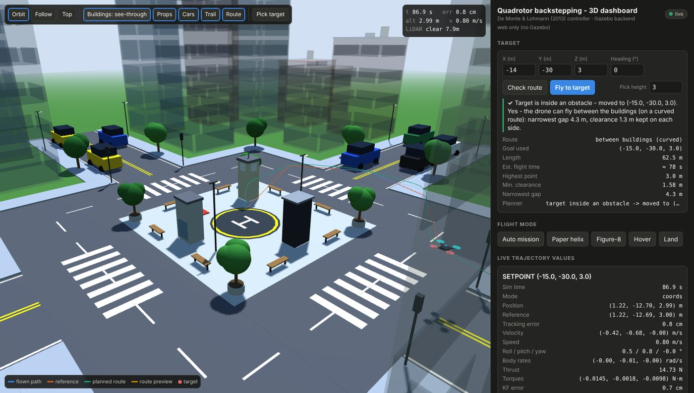

---

## Project Guide

| Role | Name | Email |
|---|---|---|
| Faculty Supervisor | Prof. S. Sunil Kumar | [s_sunilkumar@cb.amrita.edu](mailto:s_sunilkumar@cb.amrita.edu) |

---

## Team Members

| S. No. | Name | Roll Number | Email |
|---:|---|---|---|
| 1 | Kallam Pratheep Reddy | CB.SC.U4AIE24021 | kallampratheepreddy72@gmail.com |
| 2 | Chaithanya G Nambiar | CB.SC.U4AIE24013 | Cb.sc.u4aie24013@cb.students.amrita.edu |
| 3 | Surabhi Saha | CB.SC.U4AIE24057 | saha8.surabhi@gmail.com |
| 4 | Anakha | CB.SC.U4AIE24006 | anakhas443@gmail.com |
| 5 | Mahendra Mula | CB.SC.U4AIE24033 | maheshbanu58@gmail.com |

---

## Contents

1. [Abstract](#abstract)
2. [Introduction](#1-introduction)
3. [Problem Statement](#2-problem-statement)
4. [Base Paper](#3-base-paper)
5. [Methodology](#4-methodology): quaternion model, backstepping control, trajectory, noise, Kalman filter, object detection, trajectory redirection
6. [Simulation](#5-simulation): city world, MuJoCo, PyBullet, Gazebo 11, 3D web dashboard, ArduPilot
7. [Results](#6-results): paper experiments, noise and Kalman filter, obstacle detection, redirected trajectories, city flight
8. [System Architecture](#7-system-architecture)
9. [Installation](#8-installation)
10. [How to Run](#9-how-to-run)
11. [Configuration](#10-configuration-configyaml)
12. [Tests](#11-running-tests)
13. [Limitations, Future Work, Conclusion](#12-limitations)
14. [References](#15-references)

---

## Abstract

This project implements the complete backstepping trajectory tracking controller of De Monte and Lohmann [1] for a quadrotor helicopter. The attitude quaternion is split into a tilt part $`q_{xy}`$, which orients the thrust vector, and a heading part $`q_z`$. With this split, the translational dynamics and the yaw dynamics decouple. Position is controlled by a four-step backstepping design with a dynamic thrust extension, and heading by an independent two-step design. Both come with a Lyapunov proof of asymptotic stability.

The paper's controller is extended into a full guidance, navigation and control system:

- **Noise and filtering:** Gaussian sensor noise on position, velocity and gyro, a 6-state Kalman filter that uses the controller's model acceleration as input, and a gyro filter.
- **Obstacle detection:** a 10-beam LiDAR and a reactive avoider (repulsive field, wall-following circulation, side memory).
- **Trajectory redirection:** a global path planner (A\* on the city map, targets inside buildings moved out, over-the-top fallback). Its corners are rounded into one smooth $`C^1`$ curve that the drone follows through a $`C^4`$ reference model.

The same code flies a $`1.5\,\mathrm{kg}`$ quadrotor in MuJoCo and a $`27\,\mathrm{g}`$ Crazyflie in PyBullet under real rigid-body dynamics. It also drives Gazebo 11 and a 3D web dashboard through a $`500\,\mathrm{Hz}`$ Python flight core. The dashboard shows live trajectory values and charts, checks whether a route between buildings is possible before flying, and exports all trajectory values once per second. An ArduPilot / MAVLink bridge runs the full ground-station pre-flight sequence.

The paper's switched set-point and vertical-helix experiments are reproduced with sub-centimetre error. With noise and the Kalman filter, every simulator tracks the mission with about $`0.5\text{–}0.7\,\mathrm{cm}`$ RMS error. In the city, the drone reaches targets behind and between buildings while keeping more than $`1.5\,\mathrm{m}`$ from every obstacle.

---

## 1. Introduction

Autonomous quadrotor flight needs two things at once: a trajectory that is dynamically feasible and collision-free, and a controller that tracks it precisely in real time [6].

**Quaternions versus Euler angles.** Euler angles suffer from gimbal lock: at certain attitudes two rotation axes align and one degree of freedom is lost. Unit quaternions describe every attitude without this singularity [5]. This project uses quaternions throughout the model and the controller.

**Backstepping.** Backstepping is a recursive, Lyapunov-based design for systems in cascade form (position → velocity → thrust → angular rate) [3]. At each step a virtual control drives one error to zero, and the Lyapunov function is extended by that error. The result is a constructive proof of stability for the complete closed loop.

**Decoupling quaternion parametrization.** The key idea of the base paper [1], building on [2], is the factorization $`q = q_{xy} \circ q_z`$. The tilt quaternion $`q_{xy}`$ alone determines the direction of the thrust and therefore the translational motion. The heading quaternion $`q_z`$ determines only the yaw. Position and heading can therefore be controlled by two independent laws, and all control signals can be derived analytically.

---

## 2. Problem Statement

Develop and simulate a real-time trajectory tracking system for a quadrotor that:

- Represents the attitude by a unit quaternion, decomposed into tilt $`q_{xy}`$ and heading $`q_z`$ (no gimbal lock, no unwinding [4]).
- Implements the paper's full backstepping law: four-step position control with dynamic thrust extension, and heading control.
- Tracks the paper's reference trajectories (switched set points, vertical helix) and project trajectories (figure-8, mission, arbitrary set points).
- Works with realistic sensors: additive Gaussian noise on position, velocity and gyro, with a Kalman filter for state estimation.
- Detects obstacles with an onboard LiDAR and avoids them.
- Redirects the trajectory around buildings: plans a collision-free route, moves targets that are inside buildings, and flies a smooth curve instead of sharp corners.
- Runs the same controller in several simulators (MuJoCo, PyBullet, Gazebo 11) in one shared, realistic city.
- Provides a 3D web interface for targets, route checking, live values and per-second data export, plus a MAVLink bridge for ArduPilot.

---

## 3. Base Paper

P. De Monte and B. Lohmann, "Trajectory tracking control for a quadrotor helicopter based on backstepping using a decoupling quaternion parametrization," *21st Mediterranean Conference on Control and Automation (MED)*, Platanias-Chania, Crete, Greece, June 2013, pp. 507–512, doi: [10.1109/MED.2013.6608769](https://doi.org/10.1109/MED.2013.6608769).

### Main contributions of the paper

- A factorization of the attitude quaternion into tilt ($`q_{xy}`$) and heading ($`q_z`$) quaternions, free of ambiguity ($`q_p \ge 0`$, $`q_w \ge 0`$).
- Proof that this decomposition decouples the translational dynamics from the yaw dynamics.
- A backstepping trajectory tracking law with an analytical Lyapunov stability proof, in which every control signal is derived analytically.
- Experimental validation on an AscTec Hummingbird with a Vicon motion-capture system.

### What this project implements

The complete method of the paper is in `quadrotor_controller/paper_controller.py`:

- the quaternion decomposition
- the thrust-vector and heading kinematics
- the input transformation and the dynamic thrust extension
- the four-step position backstepping and the heading backstepping
- the paper's gains

`track_error.py` reproduces the paper's switched set-point and vertical-helix experiments. The earlier simplified two-step law (`controller.py`) is kept as a baseline.

---

## 4. Methodology

The system is a closed loop of five blocks. Every simulator uses the same blocks; only the "plant" (the simulated drone) changes.

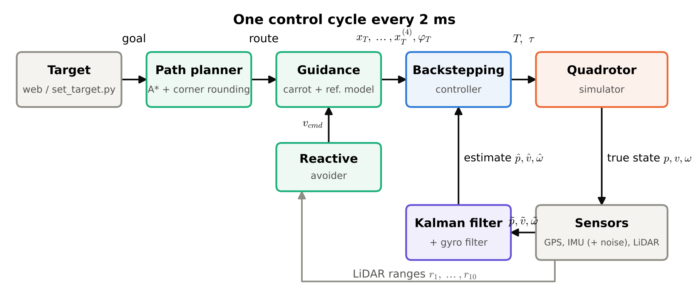

**How one control cycle goes (every $`2\,\mathrm{ms}`$):**

1. The guidance block produces the reference: where the drone should be ($`x_T`$), plus its velocity, acceleration, jerk and snap, and the desired heading $`\varphi_T`$.
2. The sensors measure the drone's position, velocity and angular rate, and the noise model corrupts them like real sensors.
3. The Kalman filter turns the noisy measurements into a clean estimate $`\hat p, \hat v, \hat\omega`$.
4. The backstepping controller compares the estimate with the reference and computes the total thrust $`T`$ and the three torques $`\tau`$.
5. The simulator applies $`T`$ and $`\tau`$ to the drone and moves it one time step forward. The LiDAR scans the surroundings for the next cycle.

The sections below explain each formula in this loop, in the order the signals flow.

---

### 4.1 Quaternion fundamentals and conventions

**Why quaternions.** The attitude (orientation) of the drone must be described without singularities. Euler angles (roll, pitch, yaw) fail at $`\pm 90^\circ`$ pitch (gimbal lock). A unit quaternion describes every orientation smoothly [5].

**Definition.** A rotation by an angle $`\alpha`$ about a unit axis $`a`$ is written as four numbers. The paper puts the vector part first and the scalar part last:

```math
q = [\,q_1\ \ q_2\ \ q_3\ \ q_4\,]^\top = \Big[\,a^\top \sin\tfrac{\alpha}{2}\ \ \ \cos\tfrac{\alpha}{2}\,\Big]^\top, \qquad \lVert q\rVert = 1
```

- $`(q_1, q_2, q_3)`$ point along the rotation axis, scaled by $`\sin(\alpha/2)`$.
- $`q_4 = \cos(\alpha/2)`$ says how large the rotation is: $`q_4 = 1`$ means no rotation.
- The length is always $`1`$, so four numbers carry three degrees of freedom.

**Rotation matrix.** A vector measured in the body frame $`B`$ (for example the thrust, which always points along the drone's own $`z`$-axis) is expressed in the world frame $`I`$ by $`{}^{I}x = R(q)\,{}^{B}x`$, where $`R(q)`$ is the $`3\times 3`$ rotation matrix built from $`q`$.

**How the attitude evolves (quaternion kinematics).** When the drone spins with angular velocity $`\omega`$ (measured in its own body frame), the quaternion changes as

```math
\dot q = \tfrac12\,Q(q)\begin{bmatrix}\omega\\ 0\end{bmatrix}, \qquad
Q(q) = \begin{bmatrix} q_4 & -q_3 & q_2 & q_1\\ q_3 & q_4 & -q_1 & q_2\\ -q_2 & q_1 & q_4 & q_3\\ -q_1 & -q_2 & -q_3 & q_4\end{bmatrix}
```

$`Q(q)\,r`$ is the quaternion product $`q \circ r`$. The equation says: the attitude rate is half of "current attitude $`\circ`$ angular velocity". The simulators integrate this equation every step, and the controller uses it to know how its torque commands will change the attitude.

> **Conventions in the code.** The code stores quaternions scalar-first, $`q = (w, x, y, z) = (q_4, q_1, q_2, q_3)`$.
>
> The world frame is ENU ($`x`$ east, $`y`$ north, $`z`$ up) and the body frame is FLU (forward, left, up), so the thrust acts along $`+z_B`$ and gravity is $`g = (0,\ 0,\ -9.81)\,\mathrm{m/s^2}`$. The paper uses NED with the thrust along $`-z_B`$. After this sign change all equations are identical.

---

### 4.2 Decoupling attitude parametrization

**The idea.** A quadrotor can only push along its own $`z`$-axis. To move sideways it must *tilt* that axis; the rotation about the axis (*heading*, or yaw) does not change where the thrust points. The paper therefore splits the attitude into two rotations, one after the other:

```math
q = q_{xy} \circ q_z = Q(q_{xy})\,q_z
```

1. $`q_{xy}`$ first tilts the world frame into an auxiliary frame $`A`$ whose $`z`$-axis is the drone's thrust axis.
2. $`q_z`$ then turns frame $`A`$ about that $`z`$-axis to the actual body frame $`B`$.

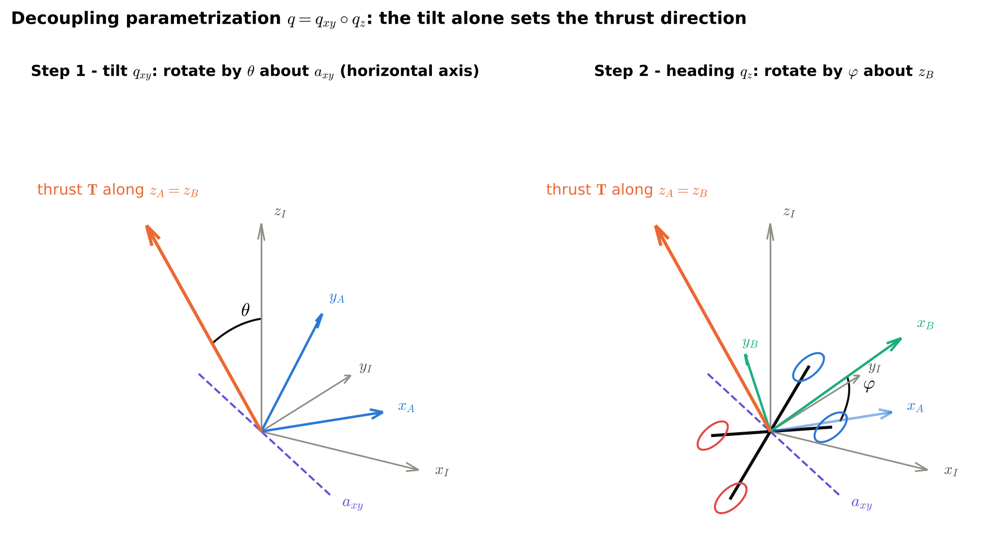

| Quaternion | Structure | Meaning | Degrees of freedom |
|---|---|---|---|
| $`q_{xy} = [\,q_x\ \ q_y\ \ 0\ \ q_p\,]^\top`$ | rotation about an axis lying in the horizontal plane (its $`z`$-part is $`0`$) | **tilt**: where the thrust points | $`2`$, since $`q_p^2+q_x^2+q_y^2 = 1`$ |
| $`q_z = [\,0\ \ 0\ \ q_z\ \ q_w\,]^\top`$ | rotation about the vertical body axis | **heading** (yaw) | $`1`$, since $`q_w^2+q_z^2 = 1`$ |

**How the parts are computed.** Multiplying out $`q_{xy} \circ q_z`$ gives $`q = [\,q_w q_x + q_z q_y,\ \ q_w q_y - q_z q_x,\ \ q_z q_p,\ \ q_w q_p\,]^\top`$. Solving these four equations for the parts gives:

```math
q_p = \sqrt{q_3^2 + q_4^2}, \qquad
q_x = \frac{q_4\,q_1 - q_3\,q_2}{q_p}, \qquad
q_y = \frac{q_4\,q_2 + q_3\,q_1}{q_p}
```

```math
q_w = \frac{\lvert q_4\rvert}{q_p}, \qquad q_z = \mathrm{sgn}(q_3 q_4)\,\frac{\lvert q_3\rvert}{q_p}, \qquad \mathrm{sgn}(0) = +1
```

- **$`q_p`$:** from the last two rows, $`q_3 = q_z q_p`$ and $`q_4 = q_w q_p`$, so $`q_3^2 + q_4^2 = q_p^2(q_z^2 + q_w^2) = q_p^2`$. Physically $`q_p = \cos(\theta/2)`$, where $`\theta`$ is the tilt of the thrust axis from vertical: $`q_p = 1`$ when the drone is level, and $`q_p \gt 0`$ as long as it is not upside down, so $`q_{xy}`$ never jumps.
- **$`q_x, q_y`$:** these give the direction of the tilt axis $`a_{xy}`$ (which way the drone leans).
- **$`q_w, q_z`$:** the cosine and sine of half the heading angle, so the heading is $`\varphi = 2\arcsin q_z`$.
- **Why the absolute values and the sign function:** $`q`$ and $`-q`$ describe the same attitude. Forcing $`q_p \ge 0`$ and $`q_w \ge 0`$ picks one of the two, so the controller always turns the short way round. Without this, it could rotate almost a full turn to reach an attitude it was already close to (the *unwinding* phenomenon [4]).

**Why this matters.** Position control needs only $`q_{xy}`$ (two numbers) and heading control needs only $`q_z`$ (one number). The two controllers can be designed separately.

---

### 4.3 Thrust vector and heading kinematics

**Thrust vector.** The thrust has magnitude $`T`$ and points along the drone's $`z`$-axis. Because frame $`A`$ shares this axis, only the tilt $`q_{xy}`$ decides its direction. Rotating the body thrust into the world frame (paper's NED frame) gives:

```math
\mathbf T = R(q_{xy})\begin{bmatrix}0\\0\\-T\end{bmatrix} = \begin{bmatrix} -2q_y q_p\\ 2q_x q_p \\ 1 - 2q_p^2\end{bmatrix} T
```

Reading it: when the drone is level ($`q_x = q_y = 0`$, $`q_p = 1`$) the vector is $`(0,\ 0,\ -T)`$, straight up against gravity in NED. Tilting ($`q_x \ne 0`$ or $`q_y \ne 0`$) gives the horizontal components that accelerate the drone sideways.

**How the thrust vector changes.** The controller cannot set $`\mathbf T`$ directly; it can only change the tilt rates $`\omega_{xy} = [\omega_x\ \ \omega_y]^\top`$ and the thrust rate $`\dot T`$. Differentiating $`\mathbf T`$ and using the quaternion kinematics gives:

```math
\dot{\mathbf T} = M(q_{xy})\,D(T)\,R_s(q_z)\begin{bmatrix}\omega_{xy}\\ \dot T\end{bmatrix}, \qquad D(T) = \mathrm{diag}(T,\ T,\ 1)
```

- $`R_s(q_z)`$ is the $`2\times 2`$ rotation by the heading. It turns the measured body rates $`\omega_{xy}`$ into frame $`A`$, where the tilt happens.
- $`D(T)`$ scales them by $`T`$: tilting a strong thrust changes the vector more than tilting a weak one.
- $`M(q_{xy})`$ is an orthogonal matrix ($`M^{-1} = M^\top`$) that maps everything into the world frame. It is always invertible, which the controller uses later.
- **Key point:** the yaw rate $`\omega_z`$ does not appear. Spinning the drone about its own axis does not move the thrust vector, so yaw cannot disturb the position.

**Heading kinematics.** The heading angle changes with the yaw rate, plus a small coupling from tilting while already tilted:

```math
\dot\varphi = \omega_z - l(q_{xy})^\top R_s(q_z)\,\omega_{xy}, \qquad l(q_{xy}) = \tfrac{1}{q_p}[\,q_y\ \ -q_x\,]^\top
```

When the drone is level, $`l = 0`$ and simply $`\dot\varphi = \omega_z`$. The second term is known exactly, so the heading controller cancels it. This equation is checked against finite differences in the tests.

---

### 4.4 Dynamic model

The drone is modelled as a rigid body. The motors react much faster than the vehicle, so, as in the paper, the total thrust and the three body torques are taken as the inputs [1], [6].

**Translational motion (Newton's law):**

```math
\dot x = v, \qquad \dot v = f(v) + g + \tfrac{1}{m}\mathbf T
```

The position $`x`$ changes with the velocity $`v`$. The acceleration is the sum of drag $`f(v)`$, gravity $`g`$ and the thrust vector divided by the mass $`m`$. Drag is linear here, $`f(v) = -c\,v`$, with $`c = 0`$ by default as in the paper's experiments.

**Rotational motion (Euler's equation):**

```math
\dot\omega = J^{-1}\big(J\omega\times\omega + \tau\big)
```

The angular acceleration comes from the torques $`\tau`$, plus the gyroscopic term $`J\omega\times\omega`$ that appears when a body with inertia $`J`$ spins about more than one axis.

**Two modelling steps make the design possible:**

**(1) Input transformation.** The controller computes a "desired angular acceleration" $`\tilde\tau`$ and converts it to a torque with

```math
\tau = -J\omega\times\omega + J\tilde\tau \quad\Rightarrow\quad \dot\omega = \tilde\tau
```

Substituting this $`\tau`$ into Euler's equation cancels the gyroscopic term, so the rotation becomes a simple double integrator.

**(2) Dynamic thrust extension.** Two integrators are added in front of the thrust: $`\ddot T = u_T`$. The new input $`u_T`$ sets the thrust's acceleration, so $`T`$ and $`\dot T`$ become smooth states the design can use, and the motor command has no jumps.

After these steps the design inputs are $`\tilde\tau_{xy}`$ and $`u_T`$ for the position, and $`\tilde\tau_z`$ for the heading.

---

### 4.5 Backstepping position control

**The chain to control.** The position is not driven directly. The input acts at the end of a chain of four links:

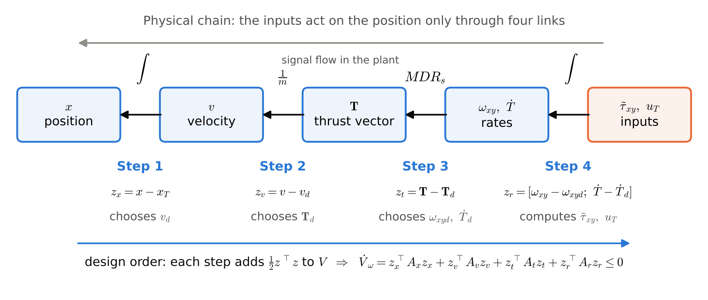

**The method [3].** Backstepping walks along this chain from the position to the input. At each step it:

1. defines an error for one link,
2. chooses a desired value ("virtual control") for the next link that would make this error shrink,
3. extends a Lyapunov function $`V`$ (an energy-like measure of all errors) and checks that it decreases,
4. passes the leftover coupling term to the next step, which cancels it.

The gains $`A_x, A_v, A_t, A_r`$ are negative, so terms like $`z^\top A z`$ are always $`\le 0`$.

**Step 1: position.** Error $`z_x = x - x_T`$ and $`V_x = \tfrac12 z_x^\top z_x`$ (half the squared distance to the reference). Its derivative is $`\dot V_x = z_x^\top(v - \dot x_T)`$. If the velocity were

```math
v_d = \dot x_T + A_x z_x
```

then $`\dot V_x = z_x^\top A_x z_x \le 0`$: follow the reference velocity, plus a correction pointing back toward the reference. But $`v`$ is not an input, so the remaining velocity error $`z_v = v - v_d`$ leaves $`\dot V_x = z_x^\top A_x z_x + z_x^\top z_v`$.

**Step 2: velocity.** $`V_v = V_x + \tfrac12 z_v^\top z_v`$. Using $`\dot v = f + g + \mathbf T/m`$, the thrust vector that makes $`\dot V_v`$ negative is

```math
\mathbf T_d = m\big(-f - g + \dot v_d - z_x + A_v z_v\big)
```

Reading it from left to right: cancel drag and gravity, add the desired acceleration $`\dot v_d`$, cancel the cross term $`z_x^\top z_v`$ left over from step 1 (that is the $`-z_x`$), and add a correction $`A_v z_v`$. The remaining thrust error $`z_t = \mathbf T - \mathbf T_d`$ leaves $`\dot V_v = z_x^\top A_x z_x + z_v^\top A_v z_v + \tfrac1m z_v^\top z_t`$.

**Step 3: thrust vector.** $`V_t = V_v + \tfrac12 z_t^\top z_t`$. The thrust vector changes through $`\dot{\mathbf T} = M D R_s\,[\,\omega_{xy};\ \dot T\,]`$. Choosing the desired rates

```math
\begin{bmatrix}\omega_{xyd}\\ \dot T_d\end{bmatrix} = R_s^\top D^{-1} M^\top\big(\dot{\mathbf T}_d + A_t z_t - \tfrac1m z_v\big)
```

inverts this map (that is why $`M`$ being orthogonal and $`D`$ being diagonal matter) and makes the thrust vector follow $`\mathbf T_d`$, again cancelling the previous cross term. $`D^{-1}`$ needs $`T \gt 0`$, which the references and limits guarantee. The remaining rate error is $`z_r = [\,\omega_{xy}-\omega_{xyd};\ \dot T-\dot T_d\,]`$.

**Step 4: rates (the real inputs).** $`V_\omega = V_t + \tfrac12 z_r^\top z_r`$. Now the inputs appear, because $`\dot\omega_{xy} = \tilde\tau_{xy}`$ and $`\ddot T = u_T`$:

```math
\begin{bmatrix}\tilde\tau_{xy}\\ u_T\end{bmatrix} = \begin{bmatrix}\dot\omega_{xyd}\\ \ddot T_d\end{bmatrix} + A_r z_r - R_s^\top D M^\top z_t
```

follow the desired rates' derivatives, correct the rate error, and cancel the last cross term.

| Step | Error | Virtual / real control | Lyapunov function |
|---|---|---|---|
| 1 Position | $`z_x = x - x_T`$ | $`v_d = \dot x_T + A_x z_x`$ | $`V_x = \tfrac12 z_x^\top z_x`$ |
| 2 Velocity | $`z_v = v - v_d`$ | $`\mathbf T_d = m\big(-f - g + \dot v_d - z_x + A_v z_v\big)`$ | $`V_v = V_x + \tfrac12 z_v^\top z_v`$ |
| 3 Thrust vector | $`z_t = \mathbf T - \mathbf T_d`$ | $`[\omega_{xyd};\ \dot T_d] = R_s^\top D^{-1} M^\top(\dot{\mathbf T}_d + A_t z_t - \tfrac1m z_v)`$ | $`V_t = V_v + \tfrac12 z_t^\top z_t`$ |
| 4 Rates | $`z_r = [\omega_{xy}-\omega_{xyd};\ \dot T-\dot T_d]`$ | $`[\tilde\tau_{xy};\ u_T] = [\dot\omega_{xyd};\ \ddot T_d] + A_r z_r - R_s^\top D M^\top z_t`$ | $`V_\omega = V_t + \tfrac12 z_r^\top z_r`$ |

**Stability.** With all cross terms cancelled, only the negative terms remain:

```math
\dot V_\omega = z_x^\top A_x z_x + z_v^\top A_v z_v + z_t^\top A_t z_t + z_r^\top A_r z_r \;\le\; 0
```

$`V_\omega`$ is zero only when all four errors are zero, and it can only decrease. So every error goes to zero: the drone converges to the reference trajectory.

**What the law needs, and practical notes:**

- **Smooth references.** $`v_d`$ contains $`\dot x_T`$, $`\mathbf T_d`$ contains $`\ddot x_T`$, $`\dot{\mathbf T}_d`$ contains $`x_T^{(3)}`$, and $`\ddot T_d`$, $`\dot\omega_{xyd}`$ contain $`x_T^{(4)}`$. The reference must therefore be differentiable four times ($`x_T \in C^4`$); section 4.7 explains how this is guaranteed.
- **Analytic derivatives.** $`\dot{\mathbf T}_d`$, $`\ddot T_d`$ and $`\dot\omega_{xyd}`$ are computed analytically from the model. Nothing is differentiated numerically, which would amplify noise.
- **What the thrust error measures.** $`z_t^\top z_t = \tilde T^2 + 2T_d(\tilde T + T_d)(1-\cos\alpha_e)`$, where $`\tilde T`$ is the magnitude error and $`\alpha_e`$ the angle between $`\mathbf T`$ and $`\mathbf T_d`$. Minimising it removes the magnitude error and rotates the thrust the short way.
- **Mass normalisation.** The code uses $`z_t = (\mathbf T - \mathbf T_d)/m`$. For $`m = 1\,\mathrm{kg}`$ this is exactly the paper's law; for other masses it only re-weights the Lyapunov function, and lets the same gains fly the $`1.5\,\mathrm{kg}`$ model and the $`27\,\mathrm{g}`$ Crazyflie.
- **Vector form.** $`M D R_s`$ is evaluated as $`\dot{\mathbf T} = R(q)\,[\,T\omega_y,\ -T\omega_x,\ \dot T\,]^\top`$ in the FLU body frame.
- **Limits.** $`0.15\,mg \le T \le 2.5\,mg`$; for the Crazyflie the upper limit is $`0.9 \cdot 4k_f\,\mathrm{RPM}_{max}^2`$.

---

### 4.6 Heading control

The heading is controlled by its own two-step backstepping, independent of the position.

**Step 1: heading angle.** The error is the angle difference wrapped to $`(-\pi,\ \pi]`$, so the drone never turns more than half a turn:

```math
z_\varphi = \mathrm{mod}(\varphi - \varphi_T + \pi,\ 2\pi) - \pi
```

With $`V_\varphi = \tfrac12 z_\varphi^2`$ and the heading kinematics $`\dot\varphi = \omega_z - l^\top R_s\,\omega_{xy}`$, the desired yaw rate is

```math
\omega_{zd} = \dot\varphi_T + a_\varphi z_\varphi + l^\top R_s\,\omega_{xy}
```

follow the reference heading rate, correct the error, and cancel the coupling from tilting.

**Step 2: yaw rate.** With $`z_{\omega z} = \omega_z - \omega_{zd}`$ and $`V = V_\varphi + \tfrac12 z_{\omega z}^2`$, the desired yaw angular acceleration is

```math
\tilde\tau_z = \dot\omega_{zd} + a_{\omega z} z_{\omega z} - z_\varphi
```

**Resulting error dynamics.** Substituting both laws gives

```math
\dot z_\varphi = a_\varphi z_\varphi + z_{\omega z}, \qquad \dot z_{\omega z} = a_{\omega z} z_{\omega z} - z_\varphi, \qquad \dot V = a_\varphi z_\varphi^2 + a_{\omega z} z_{\omega z}^2 \le 0
```

so the heading error and the yaw-rate error both go to zero, whatever the position controller is doing.

**From accelerations to torques.** The position step gives $`\tilde\tau_{xy}`$ and the heading step gives $`\tilde\tau_z`$. Together they form $`\tilde\tau`$, and the input transformation turns it into the real torque command $`\tau = -J\omega\times\omega + J\tilde\tau`$. The thrust magnitude is obtained by integrating $`u_T`$ twice.

---

### 4.7 Trajectory followed by the drone

**Why a special trajectory is needed.** Section 4.5 showed that the controller uses the reference and its derivatives up to the 4th order (snap). A target given as a jump ("go to $`(12,\ 10,\ 9)`$ now") has infinite derivatives, so it must be turned into a smooth curve first.

**Reference model.** When flying to a target (`set_target.py X Y Z`, or the web dashboard), which is the main mode, each axis of the target is passed through a 5th-order filter with five equal time constants:

```math
\frac{X_T(s)}{X_C(s)} = \frac{1}{(\tau s + 1)^5}
```

- $`X_C`$ is the commanded point and $`X_T`$ is the smooth reference the drone follows. $`s`$ is the Laplace variable.
- In the time domain it is a chain of five first-order filters: each one smooths the output of the previous one, $`\tau\,\dot y_{k+1} = y_k - y_{k+1}`$, with $`y_0 = X_C`$ and $`y_5 = X_T`$.
- Each filter in the chain removes one jump, so after five filters position, velocity, acceleration, jerk and snap are all continuous: a step command comes out as a smooth S-shaped curve, and the drone starts and stops gently. All derivatives are read directly from the chain's states.
- **Speed limit.** For a step of length $`\Delta`$, the reference speed peaks at $`v_{peak} \approx 0.195\,\Delta/\tau`$ (at $`t = 4\tau`$). The time constant is therefore chosen as $`\tau = \max(\tau_{min},\ 0.195\,\Delta / v_{max})`$, with $`\tau_{min} = 0.35\,\mathrm{s}`$ and $`v_{max} = 1.5\,\mathrm{m/s}`$, so long flights never exceed the speed limit.
- The heading uses the same idea with a 3rd-order model, which gives a heading reference continuous up to its acceleration (what the heading law needs).

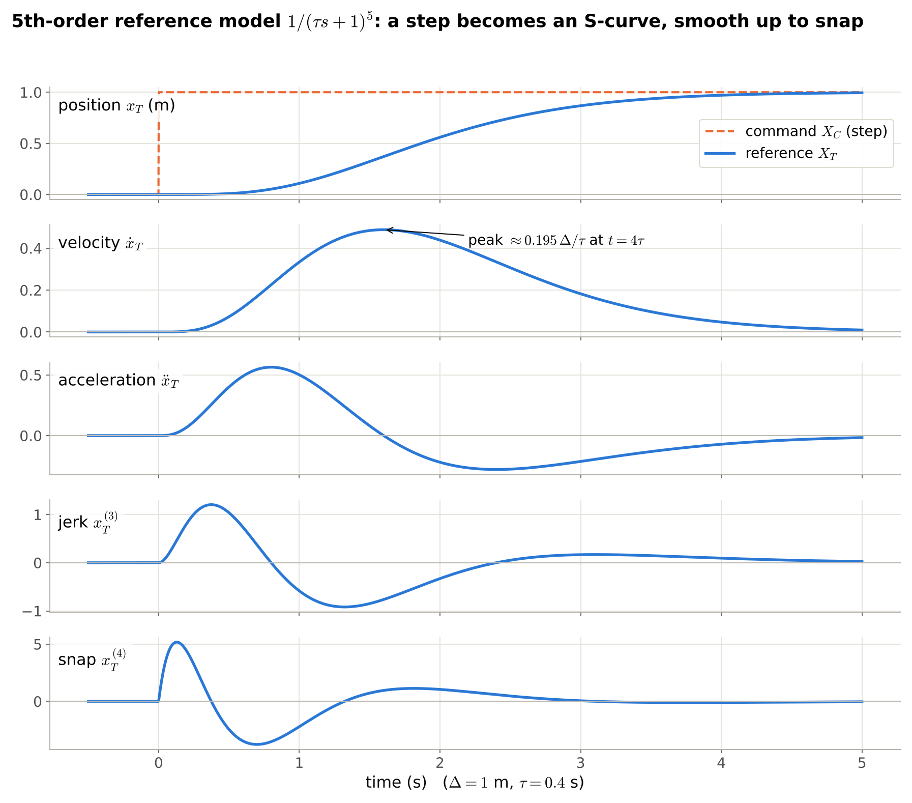

**When buildings are in the way.** The planner (section 4.13) first builds a route. The waypoints come from A\* [10], and every corner is rounded with a quadratic Bézier curve [11]:

```math
B(u) = (1-u)^2 A + 2u(1-u)P + u^2 C, \qquad u \in [0,1]
```

- $`P`$ is the corner, and $`A`$ and $`C`$ sit on the incoming and outgoing legs at distance $`r \le 10\,\mathrm{m}`$ from it.
- At $`u = 0`$ the curve starts at $`A`$ heading along the incoming leg, and at $`u = 1`$ it ends at $`C`$ heading along the outgoing leg. The direction never jumps, so the drone turns smoothly instead of stopping at the corner.
- A lead point ("carrot") moves along this curve at a constant speed and is fed to the reference model above as $`X_C`$, which smooths it into the final reference.

So the full chain is: **target → planner waypoints → rounded curve → moving carrot → 5th-order reference model → controller.**

---

### 4.8 Controller gains

| Gain (code) | Symbol | Value | Acts on | Effect of a larger magnitude |
|---|---|---:|---|---|
| `k_x` | $`A_x`$ | $`-1`$ | position error $`z_x`$ | faster return to the path |
| `k_v` | $`A_v`$ | $`-3`$ | velocity error $`z_v`$ | stiffer velocity tracking |
| `k_t` | $`A_t`$ | $`-8`$ | thrust-vector error $`z_t`$ | faster thrust-direction tracking |
| `k_r` | $`A_r`$ | $`-12`$ | rate error $`z_r`$ | stiffer attitude-rate loop |
| `k_phi` | $`a_\varphi`$ | $`-2`$ | heading error $`z_\varphi`$ | faster heading correction |
| `k_wz` | $`a_{\omega z}`$ | $`-12`$ | yaw-rate error $`z_{\omega z}`$ | stiffer yaw-rate loop |

The gains increase from the outer loop (position) to the inner loop (rates), so each inner loop settles faster than the loop around it. They are stored as positive numbers $`k = -A`$ in `config.yaml` → `controller`, and the same gains are used in every simulator.

---

### 4.9 Reference trajectories

Every reference supplies position, velocity, acceleration, jerk and snap, plus heading, heading rate and heading acceleration (`trajectory.py`). Besides the set points of section 4.7 there are three trajectory modes:

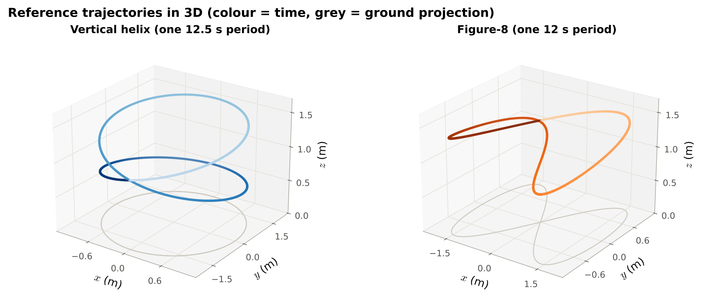

**Vertical helix (from the paper):**

```math
x_T = \sin(\omega_{xy}t), \quad y_T = -2\cos(\omega_{xy}t), \quad z_T = 1 + 0.5\sin(\omega_z t), \quad \varphi_T = \sin(\omega_z t)
```

with $`\omega_{xy} = 2\pi/6.25\,\mathrm{s}`$ and $`\omega_z = 2\pi/12.5\,\mathrm{s}`$. The drone flies an ellipse of $`2\,\mathrm{m}\times 4\,\mathrm{m}`$ every $`6.25\,\mathrm{s}`$, while its height swings between $`0.5`$ and $`1.5\,\mathrm{m}`$ and its heading swings $`\pm 1\,\mathrm{rad}`$ every $`12.5\,\mathrm{s}`$. Position and heading change at the same time, which tests the decoupling. Because sines can be differentiated any number of times, all derivatives are exact.

**Figure-8:**

```math
x_T = 2\sin(\omega t), \quad y_T = \sin(2\omega t), \quad z_T = 1.2 + 0.3\cos(\omega t), \quad \omega = 2\pi/12\,\mathrm{s}
```

$`y`$ runs at twice the frequency of $`x`$, which draws the figure-8 every $`12\,\mathrm{s}`$.

**Mission (auto mode):** takeoff → hover → helix (4 periods) → figure-8 (2 periods) → hover, repeating. Joining trajectories end-to-end would create jumps in velocity, so each piece runs on a warped time $`\tau(t)`$ instead of real time:

```math
x_T(t) = p\big(\tau(t)\big), \qquad \dot\tau(t) = s(u), \qquad s(u) = 126u^5 - 420u^6 + 540u^7 - 315u^8 + 70u^9
```

- $`p`$ is the trajectory piece and $`u \in [0, 1]`$ the normalised time within the speed-up (or slow-down) phase.
- The speed factor $`\dot\tau`$ ramps from $`0`$ to $`1`$ with the degree-9 smoothstep $`s(u)`$, whose first four derivatives are zero at both ends. The drone is at rest at every joint, and the reference stays continuous up to snap.
- The derivatives of $`p(\tau(t))`$ are computed with Faà di Bruno's formula (the chain rule for higher derivatives) [12].
- The speed never exceeds that of the individual trajectories (about $`2\,\mathrm{m/s}`$).

**Carrot.** For set points with obstacles, the command $`X_C`$ is the lead point described in 4.7. It moves along the planned curve (4.13), is steered by the avoider (4.12), and stays within $`0.8\,\mathrm{m}`$ of the reference.

---

### 4.10 Sensor noise model

**Purpose.** A real drone never knows its exact state; every sensor has noise. To test the controller realistically, `SensorNoiseModel` adds zero-mean Gaussian white noise to every measurement, independently at every $`2\,\mathrm{ms}`$ step:

```math
\tilde p = p + n_p,\quad n_p \sim \mathcal N(0, \sigma_p^2 I), \qquad
\tilde v = v + n_v,\quad n_v \sim \mathcal N(0, \sigma_v^2 I), \qquad
\tilde\omega = \omega + n_\omega,\quad n_\omega \sim \mathcal N(0, \sigma_\omega^2 I)
```

- The tilde marks a measured value; $`p, v, \omega`$ are the true position, velocity and angular rate.
- $`\mathcal N(0, \sigma^2 I)`$ means each axis gets an independent random value with mean $`0`$ and standard deviation $`\sigma`$. About $`68\,\%`$ of the samples are within $`\pm\sigma`$ and $`99.7\,\%`$ within $`\pm 3\sigma`$.

| Sensor | Standard deviation | Typical source |
|---|---:|---|
| position | $`\sigma_p = 5\,\mathrm{cm}`$ | GPS-RTK / motion capture |
| velocity | $`\sigma_v = 8\,\mathrm{cm/s}`$ | GPS velocity / optical flow |
| gyro | $`\sigma_\omega = 0.02\,\mathrm{rad/s}`$ | MEMS IMU |

**Size of the error.** With $`5\,\mathrm{cm}`$ per axis, the 3D distance error of one position measurement is $`\sqrt{3}\cdot 5 \approx 8.7\,\mathrm{cm}`$ RMS.

**Why it is a problem for this controller.** The backstepping law multiplies the errors by its gains in four stages, and the noise jumps randomly from step to step. Fed directly with $`\tilde p, \tilde v, \tilde\omega`$, the torque commands jump by large amounts every $`2\,\mathrm{ms}`$ (see 6.2). That is why the measurements go through the Kalman filter first. The values are set in `config.yaml` → `noise`; `--no-noise` switches the noise off.

---

### 4.11 Kalman filter (state estimation)

**Purpose.** The Kalman filter [7] combines two sources of information: a **prediction** from the motion model (where the drone should be, given its last estimate and the commanded acceleration) and the noisy **measurement**. It weighs them by how much each can be trusted and produces an estimate that is much more accurate than either alone.

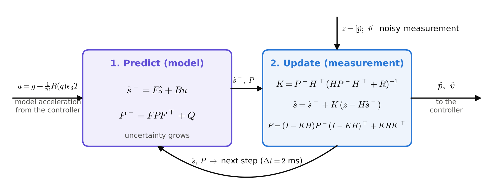

**State and model.** The filter estimates $`\hat s = [\,\hat p^\top\ \ \hat v^\top\,]^\top`$ (3D position and velocity, six numbers). Between two steps ($`\Delta t = 2\,\mathrm{ms}`$) the motion follows the constant-acceleration equations $`p_{k+1} = p_k + v_k\Delta t + \tfrac12 a\,\Delta t^2`$ and $`v_{k+1} = v_k + a\,\Delta t`$. In matrix form:

```math
s_{k+1} = F s_k + B u_k + w_k, \qquad
F = \begin{bmatrix} I_3 & \Delta t\, I_3\\ 0 & I_3\end{bmatrix}, \qquad
B = \begin{bmatrix} \tfrac12\Delta t^2 I_3\\ \Delta t\, I_3\end{bmatrix}
```

$`F`$ moves the position by velocity times time, $`B`$ adds the effect of the acceleration $`u_k`$, and $`w_k`$ is the model error.

**Control input: the controller's model acceleration.** Instead of guessing the acceleration, the filter uses the one the controller commands:

```math
u = g + \tfrac{1}{m}\,R(q)\,e_3\,T + f(v)
```

gravity, plus the thrust pointed along the drone's $`z`$-axis $`R(q)e_3`$, divided by the mass, plus drag. Because the filter knows the drone is accelerating, its prediction moves with the drone and it does not lag behind during manoeuvres. Without this input the estimate lagged by up to $`11.5\,\mathrm{cm}`$ on the helix.

**Process noise $`Q`$ (how much the model is trusted).** Unknown accelerations (wind, model errors) are modelled as white noise with $`\sigma_a = 0.3\,\mathrm{m/s^2}`$. Integrating that acceleration over one step gives, per axis:

```math
Q = \sigma_a^2 \begin{bmatrix} \Delta t^4/4 & \Delta t^3/2\\ \Delta t^3/2 & \Delta t^2\end{bmatrix}
```

The position uncertainty grows with $`(\tfrac12\Delta t^2)^2`$, the velocity uncertainty with $`\Delta t^2`$, and the two are correlated.

**Measurement noise $`R`$ (how much the sensors are trusted).** The measurement is $`z_k = [\,\tilde p^\top\ \ \tilde v^\top\,]^\top = H s_k + n_k`$ with $`H = I_6`$ (position and velocity are measured directly) and $`R = \mathrm{diag}(\sigma_p^2 I_3,\ \sigma_v^2 I_3)`$, the sensor variances from 4.10.

**The two steps, every $`2\,\mathrm{ms}`$:**

**(1) Predict:** move the estimate forward with the model, and grow its uncertainty $`P`$ (covariance) by $`Q`$:

```math
\hat s^- = F\hat s + Bu, \qquad P^- = FPF^\top + Q
```

**(2) Update:** compare the prediction with the measurement and correct it:

```math
K = P^-H^\top(HP^-H^\top + R)^{-1}, \qquad \hat s = \hat s^- + K(z - H\hat s^-), \qquad P = (I-KH)P^-(I-KH)^\top + KRK^\top
```

- $`z - H\hat s^-`$ is the *innovation*: how far the measurement is from the prediction.
- The *Kalman gain* $`K`$ decides how much of it to accept. If the prediction is uncertain ($`P^-`$ large) compared with the sensor ($`R`$), $`K`$ is large and the measurement wins; if the sensor is noisy, $`K`$ is small and the prediction wins.
- The covariance update is written in the Joseph form [8], which keeps $`P`$ symmetric and positive definite despite rounding errors.

**Gyro filter.** The angular rates are smoothed by `AngularRateFilter`, a first-order low-pass filter (equivalent to a steady-state Kalman filter):

```math
\hat\omega_k = \hat\omega_{k-1} + \alpha(\tilde\omega_k - \hat\omega_{k-1}), \qquad \alpha = 0.2
```

Each step moves the estimate $`20\,\%`$ of the way toward the new measurement, which averages out the noise over the last few steps (time constant $`\approx 10\,\mathrm{ms}`$ at $`500\,\mathrm{Hz}`$).

**Result.** The controller receives $`\hat p, \hat v, \hat\omega`$ and the attitude quaternion. The position error of what it sees drops from $`8.7\,\mathrm{cm}`$ (raw) to $`0.5\,\mathrm{cm}`$ (estimate), and the torque-command chatter drops by about $`80\times`$ (section 6.2).

---

### 4.12 Object detection: LiDAR and reactive avoidance

**Sensor.** The drone carries a 10-beam LiDAR: 8 horizontal beams $`45^\circ`$ apart, turning with the drone's heading (forward, forward-left, left, …), plus one beam up and one down. Each beam returns the distance $`r_i`$ to the first obstacle it hits, up to $`8\,\mathrm{m}`$.

| Simulator | How the beams are cast |
|---|---|
| MuJoCo | `mj_ray` against the city geometry (the target marker is excluded) |
| PyBullet | `rayTestBatch` |
| Gazebo / web flight core | vectorised slab-method ray casts against the boxes of every solid object of the same city (`world_map.WorldMap`) |

**Slab method (Gazebo / web).** A ray $`o + t\,d`$ hits an axis-aligned box $`[\ell, h]`$ if the intervals in which it lies between the box's planes overlap on all three axes $`k`$:

```math
t_{near} = \max_{k}\ \min\!\Big(\frac{\ell_k - o_k}{d_k},\ \frac{h_k - o_k}{d_k}\Big), \qquad
t_{far} = \min_{k}\ \max\!\Big(\frac{\ell_k - o_k}{d_k},\ \frac{h_k - o_k}{d_k}\Big)
```

The ray hits the box when $`t_{far} \ge t_{near} \ge 0`$, at distance $`t_{near}`$. This is computed for all $`237`$ solid boxes at once, and the smallest hit distance is the beam's range.

**Step 1: repulsion [9].** A beam with direction $`d_i`$ and range $`r_i`$ shorter than the detection distance $`d_{det}`$ sees an obstacle. Each such beam pushes the drone away, harder the closer the obstacle is:

```math
s_i = \left(\frac{d_{det} - \max(r_i,\, \kappa\, d_{safe})}{d_{det} - \kappa\, d_{safe}}\right)^{1.5}, \qquad
\mathbf r = -\sum_i s_i\, d_i
```

- $`s_i`$ is $`0`$ at the edge of the detection zone and grows to its maximum as the obstacle reaches $`\kappa\,d_{safe}`$ (with $`\kappa = 0.5`$, so very close readings do not blow up).
- The exponent $`1.5`$ makes the push gentle far away and strong close by.
- $`\mathbf r`$ adds up all pushes, each pointing away from its beam ($`-d_i`$).

**Step 2: circulation (wall following).** A pure push stops the drone in front of a wall. A sideways term is therefore added: $`\mathbf c = \pm\,\mathbf r^{\perp}`$, perpendicular to the push, so the drone slides along the obstacle. The side ($`\pm`$) is chosen once, toward the desired direction of motion, and kept (*side memory*) until the path has been clear for a while. This removes the classic potential-field trap in front of symmetric obstacles, where pushes from left and right cancel. The sum $`v_{av}`$ of push and slide is scaled to the avoidance speed.

**Step 3: blending with the nominal motion.** The closer the nearest obstacle ($`r_{min}`$), the more the avoidance velocity replaces the planned velocity $`v_{nom}`$:

```math
w = \mathrm{clip}\!\left(\frac{d_{det} - r_{min}}{d_{det} - d_{safe}},\ 0,\ 1\right), \qquad
v_{cmd} = \max(w_{min},\ 1-w)\,v_{nom} + w\,v_{av}
```

- At the detection distance $`w = 0`$: the drone follows its plan.
- At the safety distance $`w = 1`$: the avoidance velocity takes over completely.
- $`w_{min}`$ keeps a little of the goal direction at all times, so the drone keeps making progress.

**Refinements.**

- Obstacles beside or behind the direction of motion are ignored (`ignore_behind`).
- The down beam keeps a ground clearance, except while landing.
- The commanded speed is limited.
- In MuJoCo $`d_{safe} = 1.0\,\mathrm{m}`$ and $`d_{det} = 2.0\,\mathrm{m}`$; for the small Crazyflie in PyBullet they are $`0.6\,\mathrm{m}`$ and $`1.5\,\mathrm{m}`$.

**How it shapes the reference.** For set points, $`v_{cmd}`$ moves the carrot, which the reference model smooths. For trajectories (helix, figure-8), it builds a smooth, decaying offset (at most $`1.5\,\mathrm{m}`$) that is added to the reference. Either way the reference stays continuous, so the controller's requirements from 4.5 still hold.

---

### 4.13 Redirecting the trajectory: global path planner and smooth curve

**Why a planner is needed.** The LiDAR only sees a few metres and reacts locally. A large building, a closed courtyard, or a target placed inside a block cannot be solved by pushing away from walls. Every set-point command is therefore first planned on the city map (`path_planner.GridPlanner`), in the same way in every simulator.

**Step 1: target check.** Every obstacle is enlarged ("inflated") by the clearance: $`1.3\,\mathrm{m}`$ horizontally and $`1.2\,\mathrm{m}`$ vertically. A path that stays outside the inflated boxes keeps at least this distance from every real surface. If the target lies inside an inflated obstacle, it is moved to the nearest free grid point that can be reached from the drone.

**Step 2: straight line.** If the 3D segment from the drone to the target does not hit any inflated box (slab test from 4.12, with $`t \in [0, 1]`$), the drone flies straight.

**Step 3: route at cruise height (A\*).** Otherwise the drone plans at a cruise height $`z_c = \max(z_{start},\ z_{goal})`$:

- The obstacles reaching into that height are drawn into a 2D occupancy grid with $`0.5\,\mathrm{m}`$ cells.
- A\* [10] searches the grid from the start cell to the goal cell. It always expands the cell with the smallest $`f = g + h`$, where $`g`$ is the length travelled so far and $`h`$ the estimated remaining length:

```math
f(n) = g(n) + h(n), \qquad h(n) = (\Delta x + \Delta y) + (\sqrt2 - 2)\min(\Delta x, \Delta y)
```

$`h`$ is the octile distance (the exact length when moving in 8 directions with no obstacles), which never overestimates, so A\* returns the shortest route. Diagonal moves that would cut a blocked corner are not allowed.

- **Line-of-sight shortening** removes every waypoint that can be skipped without hitting an obstacle, leaving only the real corners.

**Step 4: over the top.** If no route exists at that height (the target is inside a closed courtyard), the drone climbs above the highest building on the way, crosses over, and descends to the target.

**Step 5: smooth curve.** The waypoints form a polyline with sharp corners ("straight up, then across"). Each corner $`P_i`$ is replaced by a quadratic Bézier curve [11]:

```math
B(u) = (1-u)^2 A_i + 2u(1-u)P_i + u^2 C_i, \qquad
A_i = P_i - r_i\,\hat e_{in}, \quad C_i = P_i + r_i\,\hat e_{out}, \quad u \in [0, 1]
```

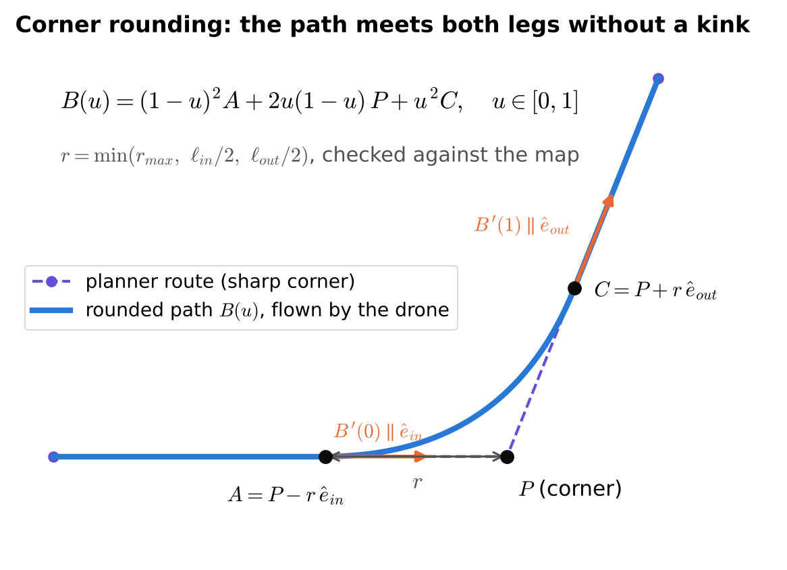

- $`\hat e_{in}`$ and $`\hat e_{out}`$ are the unit directions of the legs entering and leaving the corner; $`A_i`$ and $`C_i`$ are where the curve leaves and rejoins the legs.
- The derivative is $`B'(0) = 2(P_i - A_i)`$ and $`B'(1) = 2(C_i - P_i)`$, both along the legs, so the curve meets each leg without a kink: the whole path is $`C^1`$.
- **Radius:** $`r_i = \min(r_{max},\ \ell_{in}/2,\ \ell_{out}/2)`$ with $`r_{max} = 10\,\mathrm{m}`$, so neighbouring curves never overlap. The first and last legs can be used completely, so takeoff blends straight into the first turn (the drone climbs while it turns).
- **Collision check:** the curve is sampled every $`0.3\,\mathrm{m}`$ and checked against the map with a $`1.0\,\mathrm{m}`$ clearance (rounding a corner moves the path toward the inside of the corner). If it is not free, all radii are reduced ($`\times 0.5`$, $`\times 0.25`$, then $`0`$ = original corners).

**Step 6: following the curve.** The carrot runs along the curve samples at the cruise speed and slows down only on the last leg. The 5th-order reference model (4.7) turns it into a $`C^4`$ reference for the controller, and the LiDAR avoider (4.12) stays active the whole time as a safety layer.

| Situation | Planner decision |
|---|---|
| target in open space, line clear | straight line |
| target behind a building | climb or turn along a smooth curve around it |
| target between buildings | route through the gap if it is wider than $`2 \times 1.3\,\mathrm{m}`$ |
| target inside a building | moved to the nearest reachable free point |
| target in a closed courtyard | over the top of the buildings, then down |

---

## 5. Simulation

All simulators run the same controller, gains, noise model, Kalman filter, LiDAR avoidance and planner. They also fly in the same procedurally generated city.

| | MuJoCo [13] | PyBullet [14], [15] | Gazebo 11 [16] | 3D web dashboard |
|---|---|---|---|---|
| Vehicle | $`1.5\,\mathrm{kg}`$ quadrotor | $`27\,\mathrm{g}`$ Crazyflie CF2X | $`1.5\,\mathrm{kg}`$ (Python rigid body) | $`1.5\,\mathrm{kg}`$ (Python rigid body) |
| Physics | MuJoCo, $`500\,\mathrm{Hz}`$ | PyBullet $`1\,\mathrm{kHz}`$, control $`500\,\mathrm{Hz}`$ | Python RK4 $`500\,\mathrm{Hz}`$, pose → Gazebo | Python RK4 $`500\,\mathrm{Hz}`$ |
| Inputs | actuators: thrust + 3 torques | 4 motor RPMs (mixer) | thrust + torques | thrust + torques |
| LiDAR | `mj_ray` | `rayTestBatch` | ray cast on city map | ray cast on city map |
| Noise + KF | ✓ | ✓ | ✓ | ✓ |
| Planner + curve | ✓ | ✓ | ✓ | ✓ |
| Viewer | MuJoCo viewer, HUD, trail | PyBullet GUI, HUD, trail, keys | Gazebo GUI | browser (three.js [20]) |

### 5.1 The city world

`generate_world.py` builds the world from `config.yaml` → `world` (seed 7) and writes it in two formats: `models/city.xml` (MuJoCo, also read by PyBullet) and `models/quadrotor.world` (Gazebo).

It contains:

- a central plaza with a helipad and three obstacles for the avoidance demos (clock tower, café, metro entrance)
- a ring road and avenues with lane markings and zebra crossings
- sidewalks with trees, street lamps and traffic lights
- parked cars
- 2- to 15-storey buildings with window bands, roof units and antenna beacons

In total there are $`1307`$ primitives, $`237`$ of them solid.

### 5.2 MuJoCo

The drone is driven only by the controller's thrust and body torques (MuJoCo actuators), at $`500\,\mathrm{Hz}`$.

- **HUD:** mode, position vs. reference, Kalman-filter error, noise, thrust and LiDAR status.
- **Viewer:** a flight trail, side panels hidden, and an optional tracking camera.

The screenshot below shows the drone taking the curved route out of the plaza around the clock tower.

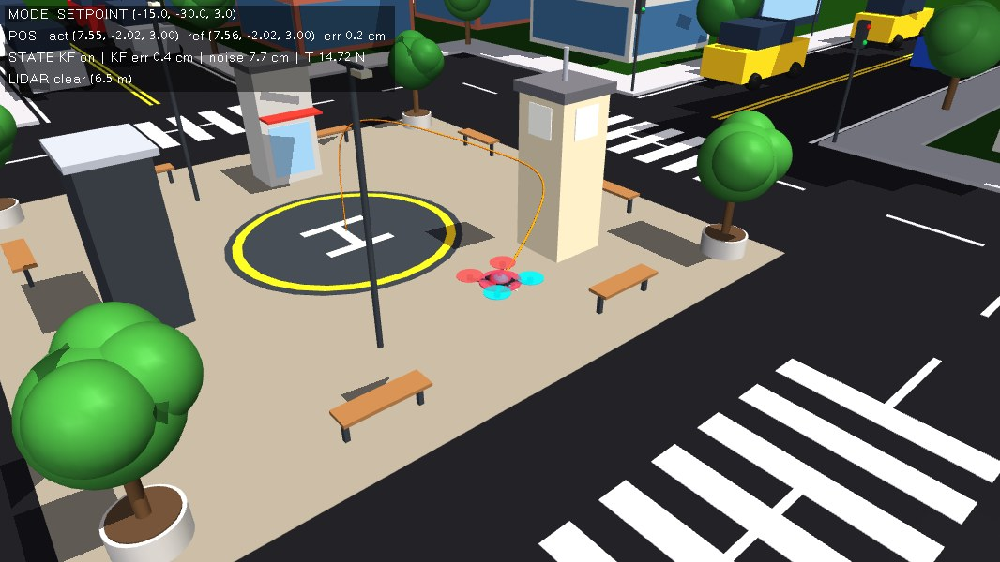

### 5.3 PyBullet (gym-pybullet-drones)

The Crazyflie CF2X [15] is driven through its four motor RPMs, computed by a force/torque mixer from the controller's thrust and torques. Physics runs at $`1\,\mathrm{kHz}`$ and control at $`500\,\mathrm{Hz}`$. PyBullet's numerical damping is switched off, because it is not physical drag. The gyro is converted to the body frame.

- **Window:** $`1280\times 720`$ without side panels, with shadows and live values pinned to the top-left corner.
- **Keys:** `1`/`2`/`3` follow / overview / top camera, `4` trail on/off, arrows rotate, `=`/`-` zoom.

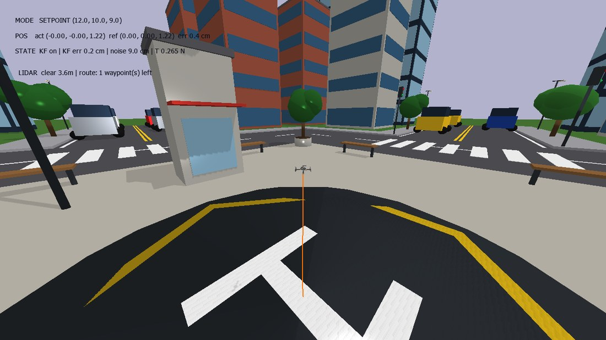

### 5.4 Gazebo 11

Gazebo's drone model is kinematic: Gazebo renders the pose computed by the $`500\,\mathrm{Hz}`$ Python flight core (`PythonFlightSim`, the same rigid-body model, controller, noise, Kalman filter, LiDAR and planner).

- **Pose transport:** a small Gazebo model plugin, `gazebo_plugin/udp_pose_plugin.cc`, receives the drone pose and the target-marker pose over UDP and applies them every physics step, so the motion is smooth. If the plugin is not built, `gz model` is used instead.
- **Launch:** `launch_gazebo_wsl.py` starts Gazebo inside WSL. It uses WSLg on Windows 11, or VcXsrv.

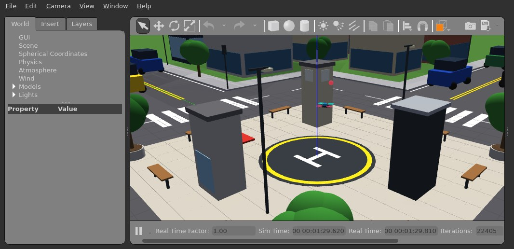

### 5.5 3D web dashboard (Gazebo backend)

`START_WEB_DASHBOARD.bat` starts Gazebo 11 and the backend, `run_web_dashboard.py`, inside WSL. The backend runs the flight core and streams every pose to Gazebo. The front end, `drone_dashboard.html`, opens in the Windows browser at http://localhost:8090.

| Feature | Description |
|---|---|
| 3D city | the same generated world; orbit / follow / top camera; buildings solid, see-through or hidden; props and cars toggles |
| Flight display | drone model, flown path, reference, planned route curve, dashed route preview, target |
| Live trajectory values | time, mode, position, reference, tracking error, velocity, speed, roll/pitch/yaw, body rates, thrust, torques, KF error, sensor noise, Lyapunov value $`V`$, LiDAR status, goal, route progress |
| Charts | $`x, y, z`$ (actual vs. reference), tracking error, speed and thrust over the last $`60\,\mathrm{s}`$, with hover values |
| Targets | type $`X, Y, Z`$ and heading, or click the ground (at a chosen height) or a roof (target above it); hovering over the city shows building heights and footprints |
| Route check | before flying: "Can the drone fly between the buildings?" Answers straight / between buildings (narrowest gap) / around / over the top / target moved; also route length, minimum clearance, highest point and estimated time |
| Modes | auto mission, paper helix, figure-8, hover, land |
| Export | all trajectory values, **one row per simulated second**, 32 columns, as CSV or JSON; each export is also saved in `results/` |

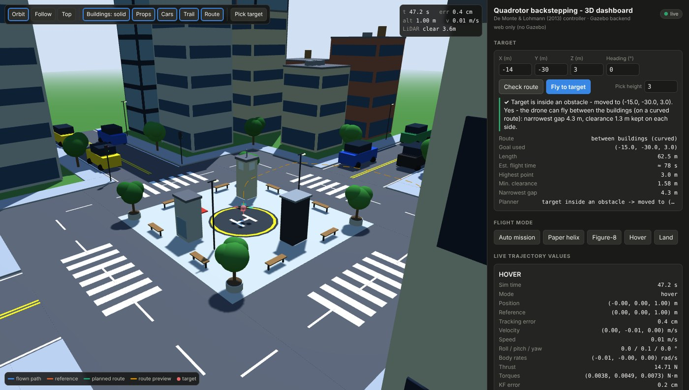

**Export columns:**

```
time_s, mode, phase, x_m, y_m, z_m, x_ref_m, y_ref_m, z_ref_m, error_m, vx_mps, vy_mps, vz_mps, speed_mps,
roll_deg, pitch_deg, yaw_deg, p_radps, q_radps, r_radps, thrust_N, tau_x_Nm, tau_y_Nm, tau_z_Nm,
kf_error_m, noise_m, lyapunov, goal_x_m, goal_y_m, goal_z_m, route_points_left, lidar
```

**Implementation:**

- The backend uses only the Python standard library and NumPy [18].
- three.js r128 [20] is bundled in `web_vendor/`, so the dashboard runs without internet.
- API: `GET /api/telemetry`, `/api/world`, `/api/route`, `/api/export.csv` and `/api/export.json`; `POST /api/command`, `/api/check_route` and `/api/clear_log`.

### 5.6 ArduPilot / MAVLink

`SITLBridge` converts ArduPilot's NED/FRD state to ENU/FLU. It sends the paper controller's body-rate reference $`(\omega_{xd},\ \omega_{yd},\ \omega_{zd})`$ and thrust with `SET_ATTITUDE_TARGET`, and ArduPilot's rate loop tracks them [17].

`run_ardupilot_sitl.py` runs the full ground-station sequence:

1. Request the state streams at $`50\,\mathrm{Hz}`$.
2. Read `MOT_THST_HOVER` and set `GUID_OPTIONS = 8` (thrust field = thrust).
3. Wait for the EKF position.
4. Switch to GUIDED and arm, each confirmed by the heartbeat.
5. Fly with the paper controller.
6. LAND and wait for the disarm.

`mock_mavlink_vehicle.py` behaves like ArduCopter for testing. Against it, the vehicle flew from $`(0,\ 0,\ 0.2)`$ to $`(1,\ 1,\ 2)\,\mathrm{m}`$ in about $`5\,\mathrm{s}`$ with no overshoot and a final error below $`1\,\mathrm{mm}`$.

---

## 6. Results

### 6.1 Paper experiments reproduced (`track_error.py`)

Rigid-body model ($`m = 1.5\,\mathrm{kg}`$, $`J = \mathrm{diag}(0.03,\ 0.03,\ 0.05)\,\mathrm{kg\,m^2}`$), RK4 at $`500\,\mathrm{Hz}`$, paper gains.

| Experiment | Controller | Sensors | RMSE (cm) | Max error (cm) | Heading RMSE (deg) | Max speed (m/s) | Max tilt (deg) | Torque chatter |
|---|---|---|---:|---:|---:|---:|---:|---:|
| Switched set points | Full 4-step paper law | ideal | 0.01 | 0.04 | 0.00 | 1.46 | 12.8 | 0.32 |
| Switched set points | Full 4-step paper law | noise + KF | 0.61 | 1.36 | 0.13 | 1.47 | 13.0 | 3.02 |
| Switched set points | Simplified 2-step (baseline) | ideal | 13.60 | 36.61 | 8.12 | 1.86 | 16.5 | 0.18 |
| Vertical helix | Full 4-step paper law | ideal | 0.00 | 0.01 | 0.00 | 2.02 | 11.8 | 0.01 |
| Vertical helix | Full 4-step paper law | noise + KF | 0.65 | 1.29 | 0.05 | 2.02 | 12.0 | 3.01 |
| Vertical helix | Full 4-step paper law | noise, no filter | 0.59 | 1.18 | 0.03 | – | – | 249.29 |
| Vertical helix | Simplified 2-step (baseline) | ideal | 20.62 | 27.41 | 6.60 | 2.33 | 13.7 | 0.02 |
| Mission (takeoff, helix, figure-8) | Full 4-step paper law | noise + KF | 0.64 | 1.34 | 0.04 | 2.03 | 12.4 | 3.00 |
| Mission (takeoff, helix, figure-8) | Simplified 2-step (baseline) | noise + KF | 17.01 | 33.73 | 3.99 | 2.34 | 17.5 | 2.98 |

The torque chatter is the RMS of the torque-command rate, $`\sqrt{\overline{\lVert\dot\tau\rVert^2}}`$ in $`\mathrm{N\,m/s}`$. The full table is in [`results_table.md`](results_table.md).

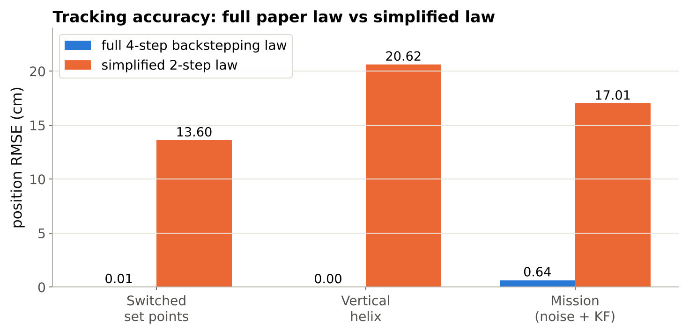

**Vertical helix.** The full law (blue) lies on the reference (grey) in $`x`$, $`y`$, $`z`$ and heading. The simplified 2-step law (orange) overshoots by about $`20\,\mathrm{cm}`$ and lags in heading. The heading follows $`\pm 1\,\mathrm{rad}`$ while the position error stays at zero, which shows the decoupling.

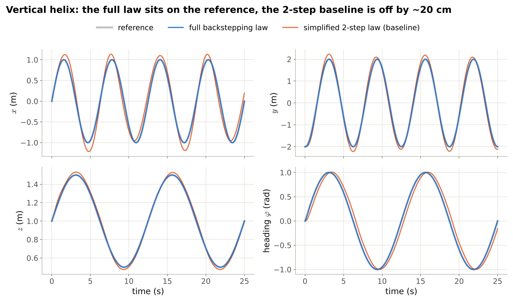

**Switched set points.** The commanded steps pass through the 5th-order reference model. The full law follows the S-curves exactly; the 2-step baseline overshoots and wobbles at every switch.

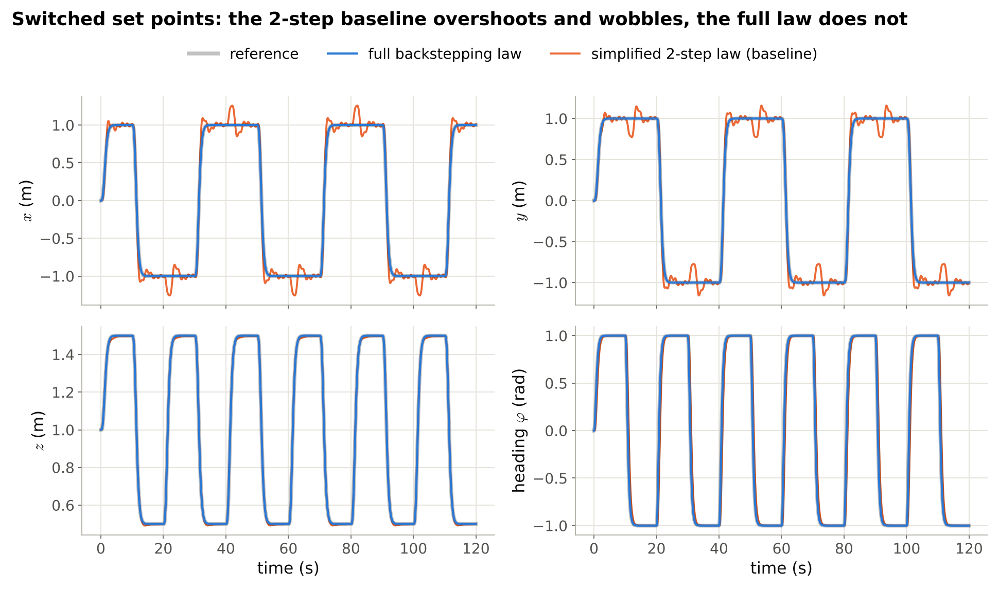

### 6.2 Sensor noise and Kalman filter

The upper plot shows the noisy position measurements (grey dots, $`\sigma_p = 5\,\mathrm{cm}`$ per axis) scattered around the true trajectory, and the Kalman-filter estimate (blue) on top of the reference. The lower plot shows the error of what the controller would see: **$`8.7\,\mathrm{cm}`$ RMS raw versus $`0.51\,\mathrm{cm}`$ RMS after the Kalman filter**, about $`17\times`$ less.

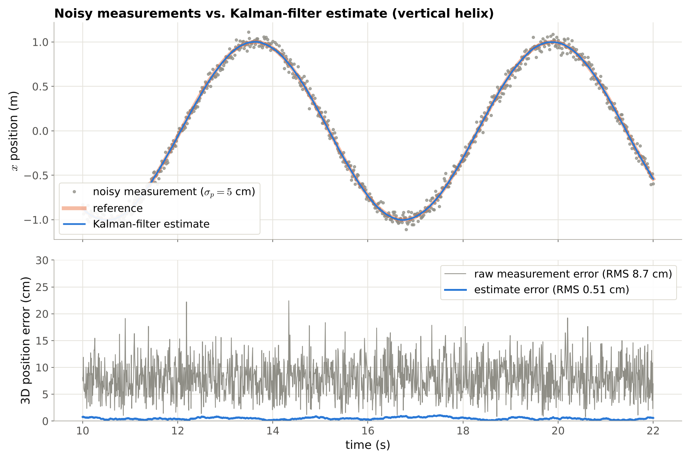

The tracking error itself is about the same with or without the filter, because the backstepping law is robust. The difference is in the actuators. Without the filter the roll torque command jumps by $`\pm 600\,\mathrm{mN\,m}`$ every step. With the filter it is smooth: the torque-rate RMS drops from **$`249`$ to $`3\,\mathrm{N\,m/s}`$**.

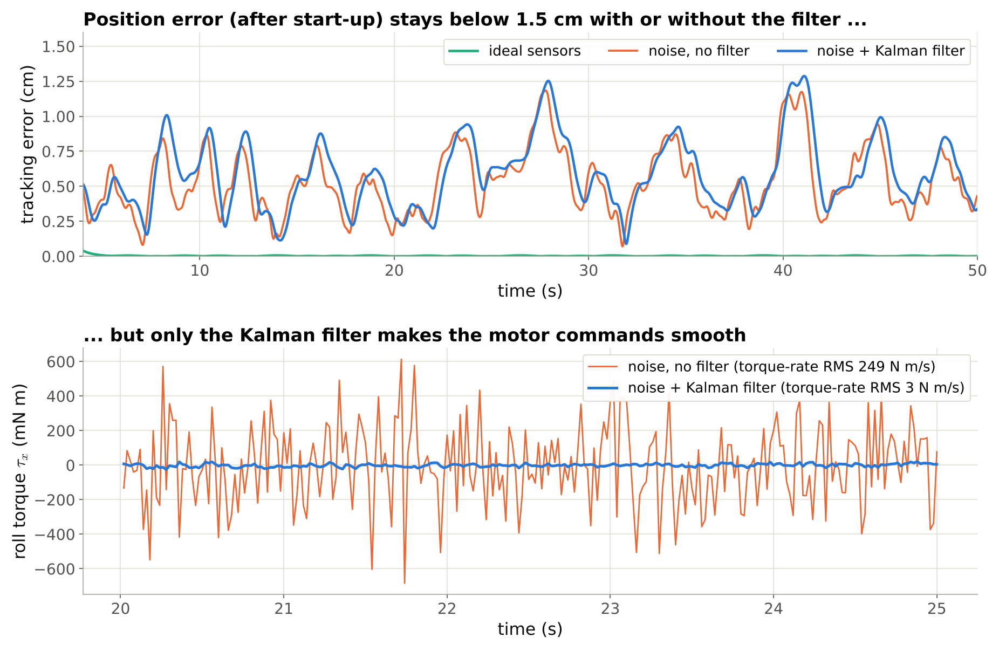

### 6.3 Full mission in the 3D simulators (noise + Kalman filter, 75 s)

| Phase | MuJoCo ($`1.5\,\mathrm{kg}`$): RMSE / max | PyBullet CF2X ($`27\,\mathrm{g}`$): RMSE / max |
|---|---|---|
| Takeoff | 0.52 / 0.92 cm | 2.16 / 7.00 cm (starts 7 cm below the first reference) |
| Hover | 0.53 / 0.80 cm | 0.53 / 0.80 cm |
| Transfer | 0.65 / 1.21 cm | 0.64 / 1.07 cm |
| Helix | 0.58 / 1.23 cm | 0.58 / 1.23 cm |
| Figure-8 | 0.70 / 1.34 cm | 0.70 / 1.33 cm |

The same gains fly two vehicles whose masses differ by a factor of $`55`$ with the same accuracy, thanks to the mass-normalised thrust error.

### 6.4 Object detection (LiDAR)

The drone is $`1\,\mathrm{m}`$ above the plaza, heading $`30^\circ`$. The forward beam detects the clock tower at $`1.8\,\mathrm{m}`$, inside the $`2.0\,\mathrm{m}`$ detection distance, so the avoider becomes active. The rear-right beam sees the metro entrance at $`5.5\,\mathrm{m}`$. The other beams are clear up to $`8\,\mathrm{m}`$.

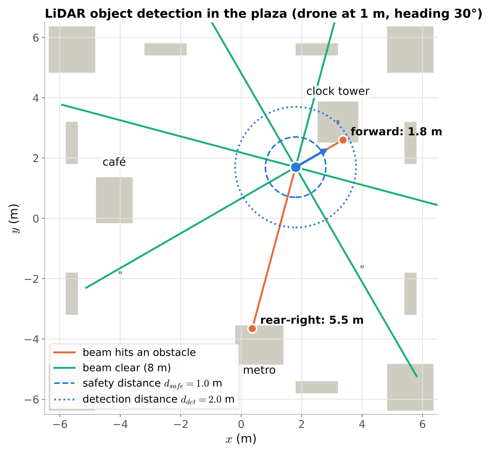

### 6.5 Redirecting the trajectory

**Planner, top view.** The target $`(-14,\ -30,\ 3)`$ is inside a building, and the straight line is blocked by several blocks.

- The planner moves the target to the nearest free point, $`(-15,\ -30,\ 3)`$.
- A\* finds a route through the streets.
- Corner rounding turns the sharp-cornered route (purple) into the smooth curve the drone actually flies (blue).

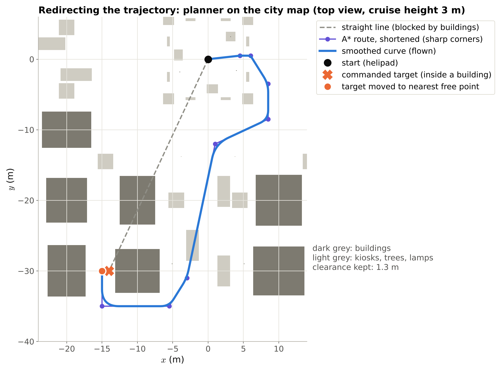

**Corner rounding, side view.** The A\* route to $`(12,\ 10,\ 9)`$ goes straight up $`8.8\,\mathrm{m}`$ and then across. The smoothed curve starts turning right after takeoff, so the drone climbs while it turns and still passes well above the clock tower.

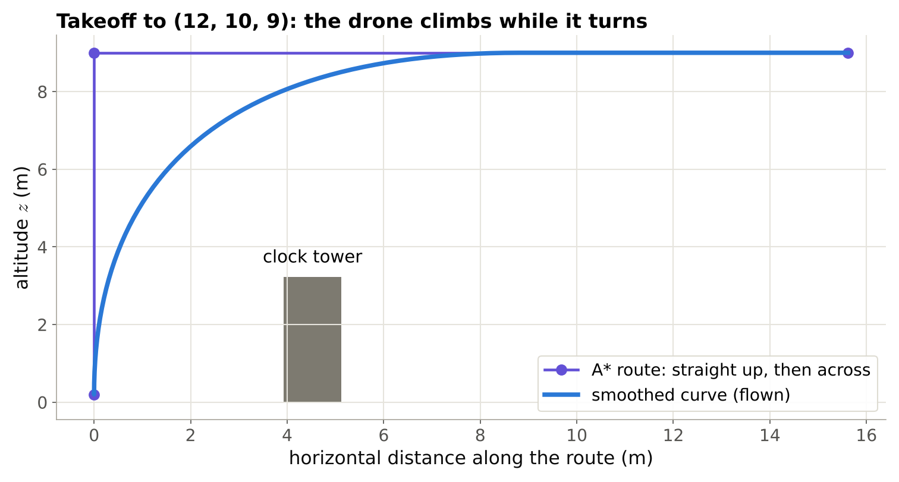

**Route-check results (web dashboard, drone at the helipad).**

| Target | Decision | Details |
|---|---|---|
| $`(2,\ 20,\ 4)`$ | between buildings, straight | narrowest gap $`9.7\,\mathrm{m}`$, clearance $`\ge 1.53\,\mathrm{m}`$, length $`20.3\,\mathrm{m}`$ |
| $`(12,\ 10,\ 9)`$ | between buildings, curved | climbs while turning, narrowest gap $`15.1\,\mathrm{m}`$, length $`20.6\,\mathrm{m}`$ |
| $`(3.2,\ 3.2,\ 1)`$ | target moved out of the clock tower | moved to $`(0.5,\ 3.0,\ 1.0)`$, direct path clear |
| $`(-14,\ -30,\ 3)`$ | target moved, between buildings, curved | moved to $`(-15,\ -30,\ 3)`$, narrowest gap $`4.3\,\mathrm{m}`$, length $`62.5\,\mathrm{m}`$ |
| $`(25,\ -20,\ 4)`$ | over the top | target inside a closed courtyard at $`4\,\mathrm{m}`$, climbs to $`22.5\,\mathrm{m}`$ |
| $`(-20,\ -20,\ 30)`$ | around | curves around the tall towers at $`30\,\mathrm{m}`$ |

### 6.6 City flight with everything active

This is the flight to $`(-14,\ -30,\ 3)`$ in the Gazebo flight core, with the paper controller, noise, Kalman filter, LiDAR avoidance and planner all active ($`95\,\mathrm{s}`$):

- **Tracking error:** $`0.64\,\mathrm{cm}`$ RMS and $`1.42\,\mathrm{cm}`$ max, the same accuracy as the paper experiments with noise.
- **Clearance:** the minimum distance to any obstacle is $`1.57\,\mathrm{m}`$, always above the $`1.0\,\mathrm{m}`$ safety distance. The LiDAR avoider was active for $`18\,\%`$ of the flight (orange dots), mainly on the last leg next to the building at the target.
- **Arrival:** the drone arrives at the moved target, $`(-15,\ -30,\ 3)`$.

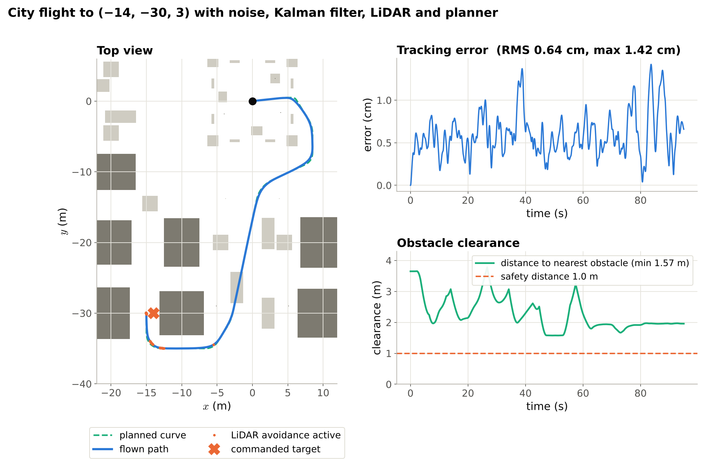

### 6.7 Key observations

1. **Decoupling works.** The decomposition $`q = q_{xy}\circ q_z`$ makes position and heading independent: the heading follows $`\pm 1\,\mathrm{rad}`$ during the helix with practically zero error, and position tracking is unaffected.
2. **The full law is far more accurate.** The 4-step law, with the dynamic thrust extension and analytic derivatives, is about $`20\text{–}40\times`$ more accurate than a 2-step PD-like simplification.
3. **Smooth references are required.** The law needs a $`C^4`$ reference. Blending moving trajectories directly produced speed overshoots ($`3.1\,\mathrm{m/s}`$); rest-to-rest speed ramps and the 5th-order reference model fixed this.
4. **The filter protects the actuators.** The error stays below $`1.5\,\mathrm{cm}`$ either way, but without the filter the torque commands are about $`80\times`$ rougher. Using the model acceleration as the filter input is essential to avoid lag.
5. **Map planning plus reactive avoidance is needed.** The reactive LiDAR avoider alone gets stuck at large buildings and cannot reach targets inside blocks. The planner handles the map-level problem, the avoider keeps the safety margin, and corner rounding makes the result one smooth curve.
6. **The simulators agree.** The same controller and gains give the same accuracy in MuJoCo ($`1.5\,\mathrm{kg}`$), PyBullet ($`27\,\mathrm{g}`$) and the Python core behind Gazebo and the web dashboard.

---

## 7. System Architecture

```
quadrotor_controller/            shared by every simulator
  paper_controller.py   PaperBacksteppingController, heading_from_quaternion
  trajectory.py         paper helix, figure-8, C^4 mission, 5th-order reference model
  guidance.py           ReferenceManager: commands, mode switching, carrot, avoidance offset, planned route
  kalman_filter.py      SensorNoiseModel, KalmanFilter, AngularRateFilter, QuadrotorStateEstimator
  obstacle_avoidance.py LidarScan, ReactiveObstacleAvoider
  path_planner.py       GridPlanner: target check, A*, line-of-sight shortening, corner rounding
  world_map.py          WorldMap: city as boxes, vectorised ray cast / LiDAR / segment checks
  world_builder.py      procedural city (config world.*) -> MuJoCo include + Gazebo SDF
  dynamics.py           RigidBodyQuadrotor (RK4)
  sim_core.py           PythonFlightSim (rigid body + controller + noise + KF + LiDAR + planner)
  sitl_bridge.py        SITLBridge (MAVLink pre-flight, NED/FRD <-> ENU/FLU)
  gazebo_tools.py       WSL helpers, UDP pose sender, Gazebo pose output
  config.py / units.py  config.yaml loader (--config / --set) and unit / layout constants
  controller.py         quaternion utilities, simplified 2-step law (baseline)

run_mujoco_simulation.py     MuJoCo 500 Hz, actuators T + tau, mj_ray LiDAR
run_pybullet_simulation.py   gym-pybullet-drones CF2X, physics 1 kHz / control 500 Hz, RPM mixer
run_gazebo_wsl_native.py     inside WSL: PythonFlightSim -> Gazebo (pose plugin or gz model)
run_gazebo_simulation.py     on Windows: PythonFlightSim -> UDP -> Gazebo in WSL
run_web_dashboard.py         web backend: flight core + Gazebo output + JSON API + per-second export
drone_dashboard.html         web front end: 3D city (three.js), live values, charts, route check, export
run_ardupilot_sitl.py        paper controller over MAVLink (pre-flight, flight, landing)
mock_mavlink_vehicle.py      ArduCopter stand-in for offline tests
run_gazebo_bridge.py         older WebSocket telemetry page (MAVLink mode)
track_error.py               paper experiments (set points, helix, mission) -> results/
generate_world.py            writes models/city.xml and models/quadrotor.world
set_target.py                writes target.txt (read by every runner)
gazebo_plugin/               udp_pose_plugin.cc (Gazebo model plugin) + build_gazebo_plugin.sh
web_vendor/                  bundled three.js r128
docs/images/                 README figures and screenshots
config.yaml                  every tunable value
requirements.txt             Python packages
```

---

## 8. Installation

**Quick install (copy and paste, Windows with Anaconda):**

```powershell
git clone https://github.com/Pratheep25082006/Drones_S5_AB9_Drones_trajectory_tracking_using_backstepping_decoupling_quaternions.git Drones
cd Drones
conda create -n drones python=3.12 -y
conda activate drones
conda install -c conda-forge pybullet -y
pip install -r requirements.txt
git clone https://github.com/learnsyslab/gym-pybullet-drones.git gym_pybullet_drones_repo
pip install -e gym_pybullet_drones_repo --no-deps
python -m pytest -q
```

**Without `requirements.txt`**, the same packages can be installed in one line:

```bash
pip install "numpy>=1.24" "scipy>=1.10" "matplotlib>=3.7" "pyyaml>=6.0" "pillow>=9.0" "mujoco>=3.1" "pybullet>=3.2.5" "gymnasium>=0.29" "pymavlink>=2.4.40" "websockets>=12" "pytest>=7.4"
```

The steps below explain each part.

### 8.1 Requirements

| Component | Version | Needed for |
|---|---|---|
| Operating system | Windows 10/11 (tested), or Ubuntu 22.04 | everything |
| Python | 3.10, 3.11 or 3.12 (64-bit) | everything |
| Git | any recent version | cloning the code |
| WSL2 + Ubuntu 22.04 | Windows only | Gazebo 11 and the web dashboard with Gazebo |
| Gazebo 11 (via Pixi) | 11.15 | Gazebo simulation (optional) |
| ArduPilot SITL | 4.x | ArduPilot test (optional) |

A graphics card is not required: MuJoCo, PyBullet and Gazebo also run with software rendering.

### 8.2 Get the code

```powershell
git clone https://github.com/Pratheep25082006/Drones_S5_AB9_Drones_trajectory_tracking_using_backstepping_decoupling_quaternions.git Drones
cd Drones
```

### 8.3 Create a Python environment

Use **one** of the two options.

**Option A: Anaconda / Miniconda (recommended on Windows)**

```powershell
conda create -n drones python=3.12 -y
conda activate drones
```

**Option B: venv**

```powershell
python -m venv .venv
.venv\Scripts\activate            # Windows (PowerShell)
# source .venv/bin/activate       # Linux / WSL
```

### 8.4 Install the Python packages

```powershell
python -m pip install --upgrade pip
pip install -r requirements.txt
```

`requirements.txt` installs:

| Package | Used for |
|---|---|
| `numpy`, `scipy` | controller, Kalman filter, planner, simulation core |
| `matplotlib`, `pillow` | result plots (`track_error.py`), PyBullet image utilities |
| `pyyaml` | reading `config.yaml` (a built-in fallback parser exists) |
| `mujoco` | MuJoCo simulation and viewer |
| `pybullet`, `gymnasium` | PyBullet simulation (gym-pybullet-drones) |
| `pymavlink`, `websockets` | ArduPilot / MAVLink bridge, WebSocket telemetry page |
| `pytest` | test suite |

> **Windows: "Microsoft Visual C++ 14.0 or greater is required" while installing `pybullet`.** pip found no ready-made wheel and tried to compile PyBullet. Install it from conda-forge instead, then run the requirements again:
>
> ```powershell
> conda install -c conda-forge pybullet -y
> pip install -r requirements.txt
> ```

### 8.5 Install gym-pybullet-drones (PyBullet simulation)

The PyBullet simulation uses the Crazyflie model and environment of gym-pybullet-drones [15], from the folder `gym_pybullet_drones_repo`:

```powershell
git clone https://github.com/learnsyslab/gym-pybullet-drones.git gym_pybullet_drones_repo
pip install -e gym_pybullet_drones_repo --no-deps
```

`--no-deps` is important: the package's own dependency list asks for `torch`, `stable-baselines3` and a newer PyBullet that has to be compiled on Windows. None of them is needed here; the packages that are needed come from `requirements.txt`. The `pip install` step is optional; the runner also finds the folder through `paths.gym_pybullet_drones` in `config.yaml`.

### 8.6 Check the installation

```powershell
python -c "import numpy, mujoco, pybullet, gymnasium; print('numpy', numpy.__version__, '| mujoco', mujoco.__version__)"
python -m pytest -q
```

Expected: `56 passed`. Then try a simulation: `python run_mujoco_simulation.py` (a window with the city opens and the drone takes off).

### 8.7 Gazebo 11 in WSL2 (optional)

Gazebo runs inside WSL2 and shows its window on Windows (WSLg on Windows 11, or VcXsrv on Windows 10). The full guide is [`GAZEBO_INSTALLATION_GUIDE.md`](GAZEBO_INSTALLATION_GUIDE.md); the short version:

1. **Install WSL2 with Ubuntu 22.04** (PowerShell as administrator, then restart):

   ```powershell
   wsl --install -d Ubuntu-22.04
   ```

2. **Install the system packages** (inside Ubuntu):

   ```bash
   sudo apt-get update
   sudo apt-get install -y build-essential cmake git curl psmisc python3 python3-numpy mesa-utils libgl1-mesa-dri
   ```

3. **Install Gazebo 11 with Pixi** (inside Ubuntu, as root, so that it lands in `/root/.pixi/envs/gazebo`):

   ```bash
   sudo -i
   curl -fsSL https://pixi.sh/install.sh | bash
   source ~/.bashrc
   pixi global install gazebo
   ```

   If Gazebo ends up in a different folder, set `gazebo.pixi_env` in `config.yaml` to that folder.
4. **Windows 10 only:** install VcXsrv (`winget install marha.VcXsrv`). On Windows 11, WSLg is used automatically (`gazebo.display: auto`).
5. **Build the pose plugin** (once; `START_WEB_DASHBOARD.bat` and `run_gazebo.sh` also do this automatically):

   ```bash
   cd /mnt/d/Drones            # your project folder seen from WSL
   bash build_gazebo_plugin.sh
   ```

6. **Test:** double-click `START_GAZEBO_GUI.bat` on Windows. The Gazebo window opens with the city (it can take $`10\text{–}30\,\mathrm{s}`$ with software rendering).

### 8.8 ArduPilot SITL (optional)

Inside Ubuntu (WSL2 or native), following the ArduPilot build instructions [17]:

```bash
git clone --recurse-submodules https://github.com/ArduPilot/ardupilot.git
cd ardupilot
Tools/environment_install/install-prereqs-ubuntu.sh -y
. ~/.profile
sim_vehicle.py -v ArduCopter --out udp:127.0.0.1:14550
```

Without ArduPilot, `python mock_mavlink_vehicle.py` provides an ArduCopter stand-in for the same test (section 9).

### 8.9 Troubleshooting

| Problem | Fix |
|---|---|
| `Microsoft Visual C++ 14.0 or greater is required` (pybullet) | `conda install -c conda-forge pybullet -y`, then `pip install -r requirements.txt` |
| pip wants to install `torch` / NumPy 2 for gym-pybullet-drones | install it with `pip install -e gym_pybullet_drones_repo --no-deps` |
| `ModuleNotFoundError: gym_pybullet_drones` | clone it into `gym_pybullet_drones_repo` (section 8.5) |
| MuJoCo window is black or does not open on Windows | update the graphics driver; `mujoco.windows_gl` in `config.yaml` selects the OpenGL backend |
| Gazebo window does not appear | wait $`30\,\mathrm{s}`$; on Windows 10 start VcXsrv; try `python launch_gazebo_wsl.py --set gazebo.display=:0` |
| `cmake: command not found` when building the plugin | `sudo apt-get install -y cmake g++ make` in WSL |
| Web dashboard: "Backend not reachable" | wait $`10\text{–}20\,\mathrm{s}`$ and refresh; or run `python run_web_dashboard.py --open-browser` (no Gazebo) |
| Port 8090 already in use | close the old console window, or change `web.port` in `config.yaml` |

---

## 9. How to Run

| What | Command |
|---|---|
| **3D web dashboard + Gazebo** | `START_WEB_DASHBOARD.bat` (Gazebo + backend in WSL, opens http://localhost:8090) |
| Web dashboard without Gazebo | `python run_web_dashboard.py --open-browser` |
| MuJoCo | `START_MUJOCO_SIM.bat` or `python run_mujoco_simulation.py` |
| PyBullet | `START_PYBULLET_SIM.bat` or `python run_pybullet_simulation.py` |
| Gazebo 11 only | `START_GAZEBO_GUI.bat` or `python launch_gazebo_wsl.py` |
| ArduPilot SITL | start SITL (section 8.8), then `python run_ardupilot_sitl.py --connect` |
| Offline MAVLink demo | `python mock_mavlink_vehicle.py`, then in a second terminal `python run_ardupilot_sitl.py --connect` |
| Paper experiments + plots | `python track_error.py` |
| Regenerate the city | `python generate_world.py` |
| Tests | `python -m pytest -v` |

Useful options for MuJoCo / PyBullet: `--headless --duration 60`, `--log run.csv`, `--no-noise`, `--no-filter`, `--no-avoid`, `--seed N`, `--ignore-target-file`, `--set key=value`.

**Commands while flying** (every runner reads `target.txt`):

```powershell
python set_target.py auto          # takeoff -> hover -> paper helix -> figure-8 (looping)
python set_target.py spiral        # paper helix
python set_target.py figure8       # figure-8
python set_target.py 12 10 9       # fly to a point (planned, smooth curve)
python set_target.py 3 -2 2.5 90   # point + heading in degrees
python set_target.py hover         # hold (0, 0, 1 m)
python set_target.py land          # return to the helipad
```

---

## 10. Configuration (`config.yaml`)

No tunable value is written in the code. Every setting lives in `config.yaml`:

| Section | Contents |
|---|---|
| `vehicle`, `controller` | mass, inertia, drag, thrust limits; the paper's gains |
| `noise`, `estimator` | sensor noise $`\sigma`$; Kalman-filter process noise, gyro filter $`\alpha`$ |
| `trajectory`, `reference_model`, `guidance` | helix, figure-8, mission timing; set-point reference model; carrot, landing |
| `avoidance` | LiDAR range and beams, safety and detection distances, circulation, blending |
| `planner` | grid resolution, clearances, corner radius, curve clearance, sample step, target-inside rule |
| `world` | city layout, buildings, roads, props, materials (`python generate_world.py` after changes) |
| `mujoco`, `pybullet`, `python_sim`, `gazebo`, `web` | simulator rates, cameras, HUD, WSL / ports, dashboard and export settings |
| `mavlink`, `mock_vehicle` | MAVLink connection and pre-flight; ArduCopter stand-in |
| `experiments`, `logging`, `numerics` | `track_error.py` settings, print / CSV periods, tolerances |

- **One run:** override a value with `--set`, e.g. `python run_mujoco_simulation.py --set controller.k_x=1.5 --set noise.pos_std=0.1`.
- **Other file:** use `--config my.yaml` or the `DRONES_CONFIG` environment variable.
- **Strict look-ups:** a missing key stops the program with its name, so there are no hidden defaults.
- **Guard test:** `tests/test_config.py` fails if a number is hard-coded in the code again.

---

## 11. Running Tests

`python -m pytest -v` runs $`56`$ tests.

| Test file | What it checks |
|---|---|
| `test_paper_controller.py` | heading kinematics vs. finite differences; hover equilibrium; sub-mm helix tracking; heading $`\pm 1\,\mathrm{rad}`$; Lyapunov function never increases; drag compensation; thrust limits |
| `test_trajectory_guidance.py` | helix parameters; derivatives up to snap; $`C^4`$ mission joints and speed bound; reference model; target parsing; continuous mode switching; avoider side memory |
| `test_kalman_filter.py`, `test_obstacle_avoidance.py` | noise model, Kalman filter, gyro filter; LiDAR scan and avoidance behaviour |
| `test_path_planner.py` | LiDAR ray cast on the city map, collision-free routes, target moved out of a building, flight to $`(12,\ 10,\ 9)`$ without touching anything |
| `test_mujoco_sim.py`, `test_pybullet_sim.py` | the paper controller flying MuJoCo and the Crazyflie under real dynamics |
| `test_web_dashboard.py` | web API, route check (between / moved / over the top), export with one row per second |
| `test_mavlink_preflight.py`, `test_sitl_bridge.py` | MAVLink pre-flight against the mock ArduCopter; frame conversions |
| `test_config.py`, `test_controller.py` | configuration (including the guard against hard-coded numbers); quaternion utilities |

---

## 12. Limitations

- Gazebo and the web dashboard render the Python rigid-body physics; their drone model is kinematic.
- Rotor dynamics are not modelled: the motors reach the commanded thrust and torques instantly, as in the paper.
- The attitude quaternion is taken from the simulator without noise; only position, velocity and gyro are noisy.
- The planner uses the known city map (static obstacles). Moving obstacles are handled only by the reactive LiDAR avoider.
- ArduPilot was tested against a MAVLink stand-in vehicle; real ArduCopter SITL still has to be run.

## 13. Future Work

- Uneven terrain (heightfield ground) with terrain following and landing on slopes.
- Attitude estimation from IMU data (EKF / complementary filter) instead of the true quaternion.
- Adaptive extension for unknown mass and drag, as suggested by the paper's authors.
- Map building from the LiDAR (occupancy grid) so the planner also works in unknown environments.
- Flight on real ArduCopter SITL and hardware through `SITLBridge`.

## 14. Conclusion

The project implements the complete backstepping trajectory tracking controller of De Monte and Lohmann [1]: the decoupling quaternion parametrization, the dynamic thrust extension, the four-step position design with its Lyapunov proof, and the independent heading control. The paper's switched set-point and vertical-helix experiments are reproduced with sub-centimetre accuracy.

The controller is extended with:

- realistic sensor noise and a Kalman filter that keeps the motor commands smooth
- LiDAR object detection with reactive avoidance
- a global planner that redirects the trajectory around and between buildings as one smooth curve

The same code flies in MuJoCo, PyBullet and Gazebo 11 in one shared city. A 3D web dashboard checks routes, shows all trajectory values live and exports them once per second for further analysis.

---

## 15. References

**Control, attitude and estimation**

1. P. De Monte and B. Lohmann, "Trajectory tracking control for a quadrotor helicopter based on backstepping using a decoupling quaternion parametrization," in *Proc. 21st Mediterranean Conference on Control and Automation (MED)*, Platanias-Chania, Crete, Greece, Jun. 2013, pp. 507–512, doi: [10.1109/MED.2013.6608769](https://doi.org/10.1109/MED.2013.6608769). **(Base paper)**
2. O. Fritsch, P. De Monte, M. Buhl, and B. Lohmann, "Quasi-static feedback linearization for the translational dynamics of a quadrotor helicopter," in *Proc. American Control Conference (ACC)*, Montreal, QC, Canada, Jun. 2012, pp. 125–130, doi: [10.1109/ACC.2012.6314682](https://doi.org/10.1109/ACC.2012.6314682).
3. M. Krstić, I. Kanellakopoulos, and P. Kokotović, *Nonlinear and Adaptive Control Design*. New York, NY, USA: Wiley, 1995, ISBN 978-0-471-12732-1.
4. S. P. Bhat and D. S. Bernstein, "A topological obstruction to continuous global stabilization of rotational motion and the unwinding phenomenon," *Systems & Control Letters*, vol. 39, pp. 63–70, 2000, doi: [10.1016/S0167-6911(99)00090-0](https://doi.org/10.1016/S0167-6911(99)00090-0).
5. M. D. Shuster, "A survey of attitude representations," *The Journal of the Astronautical Sciences*, vol. 41, no. 4, pp. 439–517, 1993.
6. R. Mahony, V. Kumar, and P. Corke, "Multirotor aerial vehicles: Modeling, estimation, and control of quadrotor," *IEEE Robotics & Automation Magazine*, vol. 19, no. 3, pp. 20–32, Sep. 2012, doi: [10.1109/MRA.2012.2206474](https://doi.org/10.1109/MRA.2012.2206474).
7. R. E. Kalman, "A new approach to linear filtering and prediction problems," *Transactions of the ASME – Journal of Basic Engineering*, vol. 82, no. 1, pp. 35–45, 1960, doi: [10.1115/1.3662552](https://doi.org/10.1115/1.3662552).
8. R. S. Bucy and P. D. Joseph, *Filtering for Stochastic Processes with Applications to Guidance*. New York, NY, USA: Interscience Publishers, 1968.

**Obstacle avoidance, path planning and curves**

9. O. Khatib, "Real-time obstacle avoidance for manipulators and mobile robots," *The International Journal of Robotics Research*, vol. 5, no. 1, pp. 90–98, 1986, doi: [10.1177/027836498600500106](https://doi.org/10.1177/027836498600500106).
10. P. E. Hart, N. J. Nilsson, and B. Raphael, "A formal basis for the heuristic determination of minimum cost paths," *IEEE Transactions on Systems Science and Cybernetics*, vol. 4, no. 2, pp. 100–107, Jul. 1968, doi: [10.1109/TSSC.1968.300136](https://doi.org/10.1109/TSSC.1968.300136).
11. G. Farin, *Curves and Surfaces for CAGD: A Practical Guide*, 5th ed. San Francisco, CA, USA: Morgan Kaufmann, 2002, ISBN 978-1-55860-737-8.
12. W. P. Johnson, "The curious history of Faà di Bruno's formula," *The American Mathematical Monthly*, vol. 109, no. 3, pp. 217–234, 2002.

**Simulators and software**

13. E. Todorov, T. Erez, and Y. Tassa, "MuJoCo: A physics engine for model-based control," in *Proc. IEEE/RSJ International Conference on Intelligent Robots and Systems (IROS)*, Vilamoura, Portugal, 2012, pp. 5026–5033, doi: [10.1109/IROS.2012.6386109](https://doi.org/10.1109/IROS.2012.6386109). Software: https://github.com/google-deepmind/mujoco
14. E. Coumans and Y. Bai, "PyBullet, a Python module for physics simulation for games, robotics and machine learning," 2016–2021. [Online]. Available: https://pybullet.org
15. J. Panerati, H. Zheng, S. Zhou, J. Xu, A. Prorok, and A. P. Schoellig, "Learning to fly—a Gym environment with PyBullet physics for reinforcement learning of multi-agent quadcopter control," in *Proc. IEEE/RSJ International Conference on Intelligent Robots and Systems (IROS)*, 2021, pp. 7512–7519, doi: [10.1109/IROS51168.2021.9635857](https://doi.org/10.1109/IROS51168.2021.9635857). Software: https://github.com/learnsyslab/gym-pybullet-drones
16. N. Koenig and A. Howard, "Design and use paradigms for Gazebo, an open-source multi-robot simulator," in *Proc. IEEE/RSJ International Conference on Intelligent Robots and Systems (IROS)*, Sendai, Japan, Sep. 2004, pp. 2149–2154, doi: [10.1109/IROS.2004.1389727](https://doi.org/10.1109/IROS.2004.1389727).
17. ArduPilot Development Team, "ArduPilot autopilot software," [Online]. Available: https://ardupilot.org. MAVLink protocol: https://mavlink.io; pymavlink: https://github.com/ArduPilot/pymavlink
18. C. R. Harris *et al.*, "Array programming with NumPy," *Nature*, vol. 585, pp. 357–362, 2020, doi: [10.1038/s41586-020-2649-2](https://doi.org/10.1038/s41586-020-2649-2).
19. J. D. Hunter, "Matplotlib: A 2D graphics environment," *Computing in Science & Engineering*, vol. 9, no. 3, pp. 90–95, 2007, doi: [10.1109/MCSE.2007.55](https://doi.org/10.1109/MCSE.2007.55).
20. three.js authors, "three.js – JavaScript 3D library," release r128, 2021. [Online]. Available: https://threejs.org
